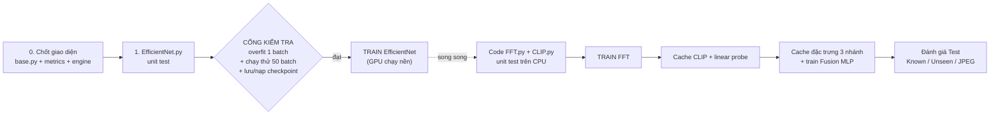

# Chốt cấu hình Bước 5B: 3 nhánh + Fusion MLP

> [!NOTE]
> Môi trường đã kiểm tra trên máy: `torch 2.6.0+cu124`, `torchvision 0.21.0`, **RTX 3050 Laptop 4 GB**, hỗ trợ **bf16**.
> Hiện **chưa cài** `open_clip_torch` (cần cho CLIP) và `scikit-learn` (cần để tính AUC/AP).

---

## 1. Bảng cấu hình tổng hợp

| Hạng mục | Spatial (EfficientNet) | Semantic (CLIP) | Spectral (FFT) |
|---|---|---|---|
| Mô hình | EfficientNet-B0 (`torchvision`) | CLIP ViT-B/16 (OpenAI, `open_clip`) | Residual Spectral CNN **tự thiết kế** |
| Trọng số khởi tạo | ImageNet-1K (`IMAGENET1K_V1`) | WIT-400M (OpenAI) | Ngẫu nhiên (Kaiming) |
| Trạng thái | **Fine-tune toàn bộ** | **Đóng băng 100%** | **Huấn luyện từ đầu** |
| Key lấy từ batch | `batch["spatial"]` | `batch["semantic"]` | `batch["spectral"]` |
| Shape đầu vào | `(B, 3, 224, 224)` | `(B, 3, 224, 224)` | `(B, 1, 224, 224)` |
| View ở Bước 3 | `view_native` (cắt 224, **không resize**) | `view_global` (resize bicubic 224 + center crop) | `view_native` → luma → FFT |
| Chuẩn hóa | Mean/std ImageNet | Mean/std CLIP | log1p + Z-score từng ảnh, DC = 0 |
| **Vector đặc trưng** | **1280 chiều** | **512 chiều** | **256 chiều** |
| Head riêng (train lẻ) | `Dropout(0.2) → Linear(1280, 1)` | `Linear(512, 1)` (linear probe) | `Dropout(0.3) → Linear(256, 1)` |
| Số tham số được train | ≈ 4,0 triệu | 513 | ≈ 4–5 triệu (ước tính) |
| Đầu ra khi train lẻ | logit `(B,)` | logit `(B,)` | logit `(B,)` |

**Fusion MLP:** ghép `1280 + 512 + 256 = 2048` chiều → logit `(B,)`.

**Thiết lập chung khi huấn luyện:** `BCEWithLogitsLoss` với nhãn `batch["label_a"]` (float 0/1); batch đã cân bằng 16:16 nên không cần `pos_weight`; AMP **bf16** (tự kiểm tra GPU, nếu không hỗ trợ thì chuyển sang fp16 + GradScaler); seed 42; `num_workers=4`; gradient clipping `max_norm=1.0`. Chọn checkpoint theo **AUC trên Val (Known)**, với `min_delta=1e-4`; khi AUC hòa thì xét **Balanced Accuracy**. Tuyệt đối không dùng Test để chọn mô hình.

> [!NOTE]
> **Chốt 1 logit + BCE (không dùng 2 logit + CrossEntropy):** với bài toán 2 lớp, hai cách tương đương về mặt toán học, vì softmax của 2 logit chính là sigmoid của hiệu hai logit. Chọn 1 logit vì nó trực tiếp là điểm số để tính AUC và khớp sẵn với `label_a` có shape `(B,)`.
> **Chọn checkpoint theo AUC, Balanced Accuracy dùng để phân xử khi hòa:** Val không cân bằng (1.459 Real : 4.377 AI, tỉ lệ 1:3). Cả AUC lẫn Balanced Accuracy đều miễn nhiễm với tỉ lệ lệch này, còn Accuracy thường thì không (đoán toàn AI vẫn được 75%). AUC được ưu tiên vì không phụ thuộc ngưỡng 0,5. Trên Val Known, AUC của EfficientNet có thể bão hòa ở mức ~0,999, khi đó chênh lệch giữa các epoch chỉ là nhiễu. `min_delta` và quy tắc phân xử bằng Balanced Accuracy xử lý trường hợp này.

---

## 2. Nhánh Spatial: vì sao EfficientNet phải fine-tune

**Quyết định: fine-tune toàn bộ, chia làm 2 pha.**

Lý do không đóng băng: đặc trưng ImageNet được học để nhận diện **vật thể** (chó, xe, ghế…), còn dấu vết AI là **vân/nhiễu mức pixel** (nhiễu upsampling, texture quá mịn). Nếu đóng băng, các lớp sâu sẽ bỏ qua đúng những dấu vết cần tìm. Nhánh CLIP đóng băng được vì nhiệm vụ của nó khác: nó lo phần ngữ nghĩa, và CLIP vốn đã được nhiều nghiên cứu (UnivFD, Ojha và cộng sự, CVPR 2023) chứng minh là tổng quát hóa tốt khi đóng băng.

| Pha | Epoch | Phần được train | Learning rate |
|---|---|---|---|
| A. Khởi động head | 1 | Chỉ head (backbone đóng băng) | head `1e-3` |
| B. Fine-tune | tối đa ~15 | Toàn bộ | backbone `1e-4`, head `1e-3` |

- Pha A tránh việc head khởi tạo ngẫu nhiên đẩy gradient lớn làm hỏng trọng số pretrained ngay ở những batch đầu.
- Dùng AdamW, weight decay `1e-4`, lịch cosine, early stopping (patience 3–4) theo AUC trên Val.
- BatchNorm vẫn để trainable (batch 32 đủ lớn để thống kê ổn định).
- Code có tham số `trainable_stages` (mặc định: toàn bộ). Nếu kết quả trên Val tốt nhưng điểm trên generator Unseen kém, chuyển sang **fine-tune một phần** (chỉ mở 1–2 stage cuối), đúng như ChatGPT đề xuất, và báo cáo như một thí nghiệm ablation. Không cần sửa code.
- Không gọi `weights.transforms()` của torchvision (Resize 256 → CenterCrop 224), vì Bước 4A đã cắt 224 và chuẩn hóa ImageNet.
- Lấy đặc trưng: `features(x)` → `(B, 1280, 7, 7)` → `AdaptiveAvgPool` → `(B, 1280)`.

---

## 3. Nhánh Semantic: CLIP đóng băng + lưu đệm đặc trưng

- Dùng `open_clip.create_model_and_transforms("ViT-B-16", pretrained="openai")`, chỉ lấy phần **visual encoder**, không dùng text encoder và không dùng caption.
- Đặc trưng = đầu ra `encode_image()` (sau lớp projection) = **512 chiều**, chuẩn hóa L2.
- `requires_grad=False` cho mọi tham số, luôn đặt `.eval()` (kể cả khi vòng train gọi `model.train()`).
- **Lưu đệm (cache):** vì backbone không đổi, chỉ cần chạy ViT **một lần** qua `build_extract_loader` cho Train (bản gốc + bản lật), Val và Test, rồi lưu ra file `.pt`. Sau đó train linear probe trên vector 512 chiều mất vài giây mỗi epoch, thay vì vài phút.

> [!WARNING]
> Lưu đệm sẽ bỏ qua augmentation JPEG ngẫu nhiên. Baseline đang để `jpeg_prob=0` nên không ảnh hưởng. Nếu sau này bật `jpeg_prob > 0`, cần lưu thêm bản JPEG hoặc chạy CLIP trực tiếp (online).

---

## 4. Nhánh Spectral: kiến trúc Residual Spectral CNN

| Tầng | Cấu hình | Kích thước đầu ra |
|---|---|---|
| Đầu vào | Phổ log-magnitude + **2 kênh tọa độ** (CoordConv) | `(B, 3, 224, 224)` |
| Stem | Conv3×3 (3→32, **stride 1**) + BN + ReLU, **không MaxPool** | `(B, 32, 224, 224)` |
| Stage 1 | 2 BasicBlock, 64 kênh, stride 2 | `(B, 64, 112, 112)` |
| Stage 2 | 2 BasicBlock, 128 kênh, stride 2 | `(B, 128, 56, 56)` |
| Stage 3 | 2 BasicBlock, 256 kênh, stride 2 | `(B, 256, 28, 28)` |
| Stage 4 | 2 BasicBlock, 256 kênh, stride 2 | `(B, 256, 14, 14)` |
| Pooling | **GAP ‖ GMP** (ghép trung bình và cực đại) | `(B, 512)` |
| Projection | Linear(512→256) + ReLU | **`(B, 256)`** |

Ba điểm khác với CNN ảnh thường, đều có lý do riêng:

1. **Stem stride 1, không MaxPool:** gai tần số của ảnh AI (ví dụ tại tần số Nyquist do upsampling) chỉ rộng **1–2 pixel**. Stem kiểu ResNet (Conv7×7 stride 2 + MaxPool) giảm độ phân giải 4 lần ngay từ đầu, dễ làm nhòe các gai này.
2. **CoordConv (thêm 2 kênh tọa độ x, y ∈ [−1, 1]):** trên ảnh phổ, **vị trí chính là tần số**. Tích chập vốn bất biến với dịch chuyển nên không biết một gai đang nằm ở tần số thấp hay cao. Hai kênh tọa độ được tạo cố định bên trong `forward()`, nên **không cần sửa `dataset.py`**.
3. **GAP ‖ GMP:** Global Average Pooling làm loãng các gai thưa. Global Max Pooling giữ lại tín hiệu mạnh nhất. Ghép cả hai giúp mô hình vừa thấy phân bố năng lượng tổng thể, vừa thấy được gai.

Siêu tham số: AdamW `lr=1e-3`, weight decay `1e-4`, 1 epoch warm-up, lịch cosine, tối đa ~30 epoch (train từ đầu nên cần nhiều epoch hơn), early stopping patience 5.

---

## 5. Fusion MLP

```text
f_spa (1280) ─ LayerNorm(1280) ─┐
f_sem (512)  ─ LayerNorm(512)  ─┼─ [Branch Dropout] ─ concat (2048)
f_spe (256)  ─ LayerNorm(256)  ─┘
   ─ Linear(2048,512) ─ GELU ─ Dropout(0.3) ─ Linear(512,128) ─ GELU ─ Dropout(0.2) ─ Linear(128,1) ─ logit (B,)
```

> [!IMPORTANT]
> **Đề xuất sửa so với bản cũ:** dùng **LayerNorm riêng cho từng nhánh** thay cho một `LayerNorm(2048)` chung. Vector CLIP đã chuẩn hóa L2 nên mỗi chiều chỉ cỡ ±0,04, trong khi đặc trưng EfficientNet lớn hơn nhiều. LayerNorm chung tính mean/std trên cả 2048 chiều, nên 1280 chiều của EfficientNet sẽ chi phối và nhánh CLIP gần như bị "chìm".

- Ba backbone **đóng băng** khi train Fusion. Đặc trưng được lưu đệm ở chế độ eval, gồm bản gốc và bản lật.
- Thêm tầng ẩn 128 (2048 → 512 → 128 → 1) theo đề xuất trùng nhau của Gemini và ChatGPT.
- **Branch dropout là tham số `branch_dropout_p`, mặc định 0 (Fusion cơ bản).** Biến thể p = 0,15, luôn giữ tối thiểu 2 nhánh, chạy như một **thí nghiệm ablation**. Fusion train chỉ mất vài giây nên chạy cả hai rất rẻ. Lý do vẫn cần thử biến thể: EfficientNet đã fine-tune trên chính tập Train nên đặc trưng của nó trên Train gần như tách biệt hoàn toàn, và Fusion có nguy cơ dựa hết vào nhánh này.
- Early stopping theo AUC trên Val.

> [!WARNING]
> Val chỉ chứa generator Known, nên **không đo được** lợi ích của branch dropout trên Unseen. Báo cáo cả hai cấu hình trên Test như một ablation. Không được chọn cấu hình "chính thức" dựa trên điểm Test Unseen, vì như vậy là rò rỉ dữ liệu Test.

---

## 6. Trình tự thống nhất: "chốt giao diện trước, qua cổng kiểm tra rồi train ngay"

> [!NOTE]
> **Số đo thực tế trên máy (06/11):** 1 epoch train = 435 batch.
> - DataLoader nhánh spatial: 0,23 s/batch với 2 worker, **0,06 s/batch với 4 worker** (máy có 12 luồng CPU).
> - GPU EfficientNet-B0 (bf16, batch 32): 0,12 s/batch, VRAM đỉnh 1,46 GB.
> - Suy ra: **khoảng 1–1,5 phút/epoch train**. Train trọn một nhánh mất **dưới 1 giờ**, không phải qua đêm.



**Ba nguyên tắc:**

1. **Chốt giao diện trước khi viết nhánh đầu tiên** (`base.py`: `input_key`, `feature_dim`, `forward_features()`, `forward()`). Mọi nhánh và Fusion đều dựa trên hợp đồng này, nên không có rủi ro phải sửa lại nhánh đã train.
2. **Qua cổng kiểm tra rồi mới train dài:** những lỗi đắt giá nằm ở engine (shape nhãn, metric, checkpoint, `set_epoch`, AMP), không nằm ở file mô hình. Unit test của từng nhánh không phát hiện được các lỗi này; chỉ một lần chạy train thật mới phát hiện được. EfficientNet là mô hình chắc chắn hoạt động, nên dùng nó để kiểm chứng engine.
3. **GPU không bao giờ chờ code:** khi EfficientNet đang train, viết FFT/CLIP và chạy unit test của chúng **trên CPU**. GPU chỉ có 4 GB VRAM, nên không chạy 2 tác vụ GPU cùng lúc.

**Vì sao thứ tự là EfficientNet → FFT → CLIP:**

| Nhánh | Code mô hình | Quy trình train | Giá trị khi làm trước |
|---|---|---|---|
| EfficientNet | Rất dễ (torchvision có sẵn, chỉ thay head) | Chuẩn, dễ kiểm chứng | **Cao nhất**: dùng để dựng và kiểm thử engine với một mô hình "chắc chắn hoạt động". Nếu kết quả tệ, lỗi nằm ở engine/data chứ không phải ở mô hình |
| FFT | Khó nhất (tự thiết kế, train từ đầu) | Dùng lại 100% engine | Chỉ thay class mô hình |
| CLIP | Dễ nhất về số dòng code | **Khác hẳn** (extract cache → probe) | Script extract của nó được tái sử dụng cho Fusion |

CLIP có ít dòng code nhất, nhưng không nên làm đầu tiên: quy trình của nó (lưu đệm rồi probe) không giúp kiểm thử được vòng train end-to-end mà EfficientNet và FFT cần.

---

## 7. "Code một nhánh rồi dùng chung cho cả 3 nhánh" nghĩa là gì

Phần **dùng chung không phải là mạng nơ-ron**, mà là **khung huấn luyện (engine)**. Mỗi nhánh tuân theo cùng một "hợp đồng" (interface):

```python
class BranchBase(nn.Module):
    input_key: str        # "spatial" | "semantic" | "spectral"
    feature_dim: int      # 1280 | 512 | 256
    def forward_features(self, x) -> Tensor:  # (B, feature_dim)  -> dùng cho Fusion
    def forward(self, x) -> Tensor:           # (B,) logit         -> dùng khi train lẻ
```

Nhờ vậy, engine chỉ cần viết **một lần** và không quan tâm bên trong là mô hình nào:

```python
x      = batch[model.input_key].to(device, non_blocking=True)
logits = model(x)
loss   = bce(logits, batch["label_a"].to(device))
```

Đổi nhánh chỉ cần đổi tham số: `train_branch.py --branch spatial` → `--branch spectral`. Loop, AMP, optimizer, scheduler, early stopping, checkpoint, tính AUC/ACC/AP và đánh giá theo từng generator đều giữ nguyên. Fusion cũng chỉ gọi `forward_features()` của cả 3 nhánh.

### Danh sách file cần code

| File | Nội dung |
|---|---|
| `code/system/branch/base.py` | `BranchBase`: `input_key`, `feature_dim`, `forward_features()`, `forward()` → `(B,)`, `count_parameters()`, `freeze_backbone()`. **Không** đặt `no_grad` ở lớp cơ sở |
| `code/system/branch/EfficientNet.py` | `SpatialBranch` + unit test (shape, số tham số, pha A/B, `trainable_stages`) |
| `code/system/branch/FFT.py` | `SpectralBranch` (CoordConv, ResBlock, GAP‖GMP) + unit test trên CPU |
| `code/system/branch/CLIP.py` | `SemanticBranch` (đóng băng, `no_grad` + `.eval()` **chỉ bên trong nhánh này**) + unit test (không có gradient) |
| `code/system/branch/fusion_mlp.py` | `FusionMLP` (LayerNorm từng nhánh, 2048→512→128→1, `branch_dropout_p`, chọn được tập con nhánh) |
| `code/system/train/metrics.py` | AUC, Balanced Acc, AP, ACC@0.5, Precision, Recall, F1, FPR, **tính trên toàn tập** (không lấy trung bình theo batch); đánh giá cặp 1:1 Real với từng generator, macro-average Known/Unseen |
| `code/system/train/engine.py` | `train_one_epoch(max_batches)`, `evaluate()`, `fit()`, `overfit_single_batch_check()`, `EarlyStopping`, `save/load_checkpoint` |
| `code/system/train/train_branch.py` | CLI train lẻ (`--branch spatial|spectral`, `--sanity-check`) |
| `code/system/train/extract_features.py` | Lưu đệm đặc trưng cả 3 nhánh qua `build_extract_loader` (tuần tự, **không** dùng Sampler) |
| `code/system/train/train_fusion.py` | Train Fusion và linear probe CLIP trên đặc trưng đã lưu đệm; ablation 7 tổ hợp nhánh |

> [!TIP]
> Khi train lẻ một nhánh, luôn truyền `active_branches=("spatial",)` (hoặc nhánh tương ứng) vào `build_dataloaders()`. DataLoader sẽ bỏ qua tiền xử lý của 2 nhánh còn lại, giảm đáng kể tải CPU, vốn thường là nút thắt trên laptop.


---

## 8. Nhật ký sửa đổi sau phản biện của Gemini và ChatGPT (07/11)

### 8.1. Các điểm chấp nhận và đưa vào thiết kế

| # | Nội dung | Nguồn | Cách thực hiện |
|---|---|---|---|
| 1 | Cổng kiểm tra overfit 1 batch **không** bắt buộc loss về 0 | ChatGPT | Điều kiện đạt: loss giảm **≥ 90% so với ban đầu** và accuracy trên chính batch đó đạt 100% sau tối đa 100 bước |
| 2 | Kiểm tra checkpoint so sánh **dự đoán**, không chỉ so AUC | ChatGPT | Lưu rồi nạp lại, ở chế độ `eval()`, `allclose(logits_trước, logits_sau)` trên cùng một batch |
| 3 | Engine gọi **tường minh** `train_dataset.set_epoch(epoch)` và `train_sampler.set_epoch(epoch)` | ChatGPT | Cả hai lệnh đều idempotent (gọi lại với cùng epoch không gây hại), nên giữ được `attach_sampler` trong `dataset.py` mà không lo gọi trùng |
| 4 | Không đặt `torch.no_grad()` trong `BranchBase` | ChatGPT | `no_grad` chỉ nằm trong `SemanticBranch.forward_features()` |
| 5 | Ghép đặc trưng 3 nhánh **theo `filepath`/`sample_idx`**, không ngầm định theo thứ tự dòng | ChatGPT | `extract_features.py` lưu kèm `filepath`, `sample_idx`; `train_fusion.py` dùng `assert` để kiểm tra 3 file khớp nhau trước khi `concat` |
| 6 | Trích xuất toàn bộ 27.812 ảnh Train, không dùng `BalancedGroupSampler` | ChatGPT | **Đã có sẵn:** `build_extract_loader` duyệt tuần tự (unit test số 10 của `dataset.py`) |
| 7 | Khi train Fusion vẫn giữ cân bằng 1:1 và augmentation lật | Gemini | `CachedFeatureDataset` dùng lại `BalancedGroupSampler` trên `train_df`. Mỗi mẫu tung đồng xu chọn bản gốc hay bản lật, **đồng bộ cho cả 3 nhánh**. Chỉ số khớp nhau vì `sample_idx` chính là số thứ tự dòng của `train_df` |
| 8 | Checkpoint lưu đủ: model, optimizer, scheduler, scaler (`None` khi dùng bf16), epoch, best metric, config | ChatGPT, Gemini | `save_checkpoint()` trong `engine.py` |
| 9 | Tự kiểm tra GPU có hỗ trợ bf16 không, nếu không thì dùng fp16 + GradScaler | ChatGPT | `engine.py` |
| 10 | Gradient clipping `max_norm=1.0`; `max_batches` cho cổng kiểm tra | Gemini | `train_one_epoch()` |
| 11 | Unit test của FFT/CLIP chạy trên CPU và **giới hạn số luồng CPU** khi GPU đang train | Gemini, ChatGPT | Dùng `torch.set_num_threads(2)` để không tranh CPU với 4 worker của DataLoader |
| 12 | Fusion thêm tầng ẩn 128 | Gemini, ChatGPT | 2048 → 512 → 128 → 1 |
| 13 | Metric tính trên toàn tập, không lấy trung bình theo batch | ChatGPT | `evaluate()` gom toàn bộ logits rồi mới gọi `metrics.py` |
| 14 | JPEG robustness là một lượt đánh giá riêng, báo cáo riêng | ChatGPT | `build_extract_loader("test", fixed_jpeg_quality=q)` với q ∈ {90, 70, 50, 30} |
| 15 | Đánh giá cặp 1:1 dùng lại cùng 7.300 ảnh Real: báo cáo từng generator và macro-average, **không** coi 5 cặp là 5 tập quan sát độc lập | ChatGPT | Ghi chú phương pháp trong Chương 4 |
| 16 | Ablation 7 tổ hợp nhánh | Gemini | `train_fusion.py --branches ...`. Mọi tổ hợp dùng **cùng loại head, cùng quy trình train** để so sánh công bằng. Kết quả từ head riêng của từng nhánh được báo cáo thêm |

### 8.2. Các điểm có điều chỉnh hoặc không theo hoàn toàn

| Đề xuất | Nguồn | Quyết định | Lý do |
|---|---|---|---|
| Dùng Balanced Accuracy làm metric **chính** để chọn checkpoint | ChatGPT | **Giữ AUC làm metric chính**; Balanced Accuracy dùng để phân xử khi AUC hòa (`min_delta=1e-4`) | Cả hai đều miễn nhiễm với tỉ lệ 1:3. AUC không phụ thuộc ngưỡng. Khi chuyển sang generator Unseen, phân phối điểm số thường bị dịch, nên ngưỡng 0,5 không còn tối ưu, còn AUC vẫn phản ánh đúng khả năng tách lớp |
| Branch dropout bật mặc định với p = 0,15 | Gemini | **Mặc định tắt (p = 0)**, chạy biến thể p = 0,15 như ablation | Theo ChatGPT: đường cơ sở sạch trước, cải tiến sau. Lập luận "tăng vọt trên Unseen" của Gemini là giả thuyết, chưa được kiểm chứng |
| Branch dropout "chỉ thử sau" | ChatGPT | Code sẵn tham số ngay từ đầu | Chi phí bằng 0, Fusion train chỉ mất vài giây |
| CLIP train qua `train_branch.py --branch semantic` | Gemini | Linear probe CLIP được train trong `train_fusion.py --branches semantic --head linear` trên đặc trưng đã lưu đệm | Không cần viết nhánh xử lý riêng cho CLIP trong engine; `train_branch.py` chỉ phục vụ spatial và spectral |
| Kiểm tra "3 epoch phủ đủ 3 ảnh AI mỗi group" ở cổng kiểm tra | ChatGPT | Không lặp lại | **Đã được kiểm thử** trong unit test của `balance_sample.py` |

### 8.3. Việc cần làm trước khi code

- [x] Cài `scikit-learn` (cho AUC/AP) vào `venv` (Đã cài & hoạt động).
- [ ] Cài `open_clip_torch` (cho CLIP) vào `venv` khi triển khai nhánh Semantic.

---

## 9. Bảng thông số kỹ thuật chi tiết phục vụ báo cáo: Nhánh Spatial (EfficientNet-B0 Baseline)

> [!NOTE]
> Mục này ghi lại toàn bộ thông số thực nghiệm chính thức đã được kiểm chứng qua Cổng kiểm tra 3 bước (`--sanity-only` đạt 100% PASS trên card RTX 3050 Laptop ngày 09/11/2026). Dùng làm dữ liệu gốc để trích dẫn vào Chương 3 (Phương pháp đề xuất) và Chương 4 (Thực nghiệm & Đánh giá) của Đồ án tốt nghiệp.

### 9.1. Kiến trúc mạng và Phân bổ tham số (Model Architecture)
* **Khung xương (Backbone):** `EfficientNet-B0` (chuẩn `torchvision.models.efficientnet_b0`, bản quyền ImageNet-1K V1).
* **Đầu vào (Input Shape):** `(B, 3, 224, 224)` với `input_key = "spatial"`, trích xuất trực tiếp từ `view_native` (cắt $224 \times 224$ nguyên pixel gốc, không qua nội suy bicubic/bilinear nhằm bảo tồn toàn vẹn tạo tác tần số cao và nhiễu vi mô).
* **Chuẩn hóa (Normalization):** Chuẩn ImageNet (Mean: `[0.485, 0.456, 0.406]`, Std: `[0.229, 0.224, 0.225]`).
* **Đầu phân loại (Classifier Head):** Thay thế hoàn toàn lớp 1.000 lớp ban đầu bằng:
  $$\text{Classifier}(f) = \text{Linear}(1280 \to 1) \circ \text{Dropout}(p=0.2)$$
* **Phân bổ tham số chi tiết:**
  - Tổng số tham số mô hình: **`4,008,829` tham số**.
  - Phần thân Backbone: **`4,007,548` tham số** (gồm 9 stage: stage 0 là Stem Conv3×3; stages 1–7 là các khối MBConv; stage 8 là Conv1×1 chuyển kênh lên 1280).
  - Phần đầu Classifier: **`1,281` tham số** (Weight: $1 \times 1280$, Bias: $1$).

### 9.2. Chiến lược Huấn luyện 2 Pha Vi sai (Two-Phase Differential Fine-Tuning)
Mô hình giải quyết triệt để xung đột giữa đặc trưng cấp cao ImageNet và tạo tác pixel của ảnh AI thông qua 2 pha liên tục (tổng cộng 16 epochs, chỉ số epoch liên tục `0 .. 15` để `BalancedGroupSampler` không bị đứt chu kỳ xoay vòng dữ liệu):

| Thuộc tính | Pha A: Khởi động Head (Warmup Head) | Pha B: Tinh chỉnh Toàn phần (Full Fine-tuning) |
| :--- | :--- | :--- |
| **Khoảng Epoch** | **Epoch 0** (1 epoch) | **Epochs 1 .. 15** (15 epochs) |
| **Vùng tham số học** | Chỉ `classifier` (**1,281 tham số**) | Mở khóa toàn bộ Backbone + Head (**4,008,829 tham số**) |
| **Trạng thái Backbone** | **Khóa cứng tuyệt đối:** `requires_grad=False`, khóa toàn bộ 49 lớp `BatchNorm2d` ở chế độ `.eval()` và 16 tầng `StochasticDepth` ở chế độ `.eval()` (drop_path = 0). | Mở khóa theo `trainable_stages="all"`. Các tầng BatchNorm2d được cập nhật thống kê running stats phù hợp với phân phối ảnh AI. |
| **Thuật toán Tối ưu** | `AdamW` (1 param_group: `head`) | `AdamW` (tạo mới hoàn toàn với 2 param_groups: `backbone` và `head`) |
| **Tốc độ học (LR)** | $\text{head\_lr} = 1.0 \times 10^{-3}$ | $\text{backbone\_lr} = 1.0 \times 10^{-4}$ (chậm hơn 10 lần) <br> $\text{head\_lr} = 1.0 \times 10^{-3}$ |
| **Lịch trình LR (Scheduler)**| Không dùng (`None`) | `CosineAnnealingLR` với $T_{\max} = 15$, hạ từ $10^{-4} \to \eta_{\min} = 10^{-6}$ |
| **Chuyển giao trạng thái** | Lấy trọng số Classifier tốt nhất Pha A nạp sang Pha B | Tiếp tục tích lũy chỉ số trên cùng bộ điều khiển `EarlyStopping` |

### 9.3. Tối ưu hóa, Hàm mất mát và Tiêu chí Kiểm định
* **Hàm mất mát (Loss):** `BCEWithLogitsLoss()` trên 1 logit đầu ra `(B,)` kết hợp nhãn thực `batch["label_a"]` dạng nhị phân (`0.0` = Real, `1.0` = AI). Không cần `pos_weight` vì mỗi batch luôn được cân bằng đúng 16 Real : 16 AI.
* **Cắt tỉa Gradient (Gradient Clipping):** `max_norm = 1.0` theo chuẩn $L_2$ để kiểm soát độ ổn định khi mở khóa backbone.
* **Suy giảm trọng số (Weight Decay):** $1.0 \times 10^{-4}$ cho cả 2 pha.
* **Chiến lược Dừng sớm (Early Stopping):**
  - Số epoch kiên nhẫn (`patience`): **4 epochs**.
  - Ngưỡng tiến bộ tối thiểu (`min_delta`): **$1.0 \times 10^{-4}$ ($0.0001$)**.
  - Chỉ số mục tiêu chính (`primary_metric`): **`AUC` trên tập Validation Known (5.836 ảnh)**.
  - Phân xử hòa (`secondary_metric`): **`Balanced Accuracy`** (khi chênh lệch AUC $\le 10^{-4}$, mô hình có Balanced Accuracy cao hơn sẽ giành quyền lưu checkpoint `best_spatial.pth`).
  - **Nguyên tắc bảo vệ:** Tuyệt đối không dùng tập Test để chọn checkpoint hay điều chỉnh siêu tham số.

### 9.4. Dữ liệu và Thiết lập Nạp dữ liệu (Dataset & DataLoader)
* **Kích thước Lô (Batch Size):** `batch_size = 32` (Train: 16 Real MS-COCO : 16 AI), `eval_batch_size = 32`.
* **Bộ chọn mẫu (Sampler):** `BalancedGroupSampler` xoay vòng đều đặn 100% kho dữ liệu AI qua chu kỳ 3 epochs.
* **Cấu hình Đa tiến trình trên Windows:**
  - `num_workers = 2` cho Train Loader kèm `persistent_workers = True` (giữ tiến trình sống liên tục, tránh nghẽn I/O và triệt tiêu độ trễ spawn tiến trình của Windows).
  - `eval_workers = 2` cho Val Loader và Test Loader kèm `persistent_workers = False` (tự giải phóng bộ nhớ ảo ngay sau khi đánh giá xong).
* **Độ tất định và Tái lập (Determinism & Reproducibility):**
  - Cố định hạt giống: `seed = 42`.
  - Đồng bộ chu kỳ `epoch` qua bộ nhớ dùng chung (Shared Memory) của `CommonProcess`, bảo đảm bộ sinh số ngẫu nhiên lật ảnh được tái tạo chuẩn xác $100\%$ kể cả khi Resume.

### 9.5. Phần cứng, Tối ưu Bộ nhớ và Tệp Xuất xưởng
* **Phần cứng thực thi:** NVIDIA GeForce RTX 3050 Laptop GPU (4 GB VRAM, kiến trúc Ampere).
* **Tự động chuyển đổi kiểu số (AMP):** Kích hoạt Native Mixed Precision với `dtype = torch.bfloat16` (dải động số mũ tương đương FP32, loại bỏ hoàn toàn nguy cơ tràn số Underflow/Overflow mà không cần dùng `GradScaler`).
* **Vị trí lưu trữ Checkpoints và Báo cáo:**
  - Thư mục làm việc: `code/system/checkpoints/spatial_baseline/`
  - Tệp Checkpoint tốt nhất: `best_spatial.pth` (dùng cho suy luận và trích xuất đặc trưng phục vụ Fusion).
  - Tệp Checkpoint gần nhất: `last_spatial.pth` (chứa trọn vẹn trạng thái Model, Optimizer, Scheduler, EarlyStopping, RNG và `dataset_manifest_hash` để Resume tự thân).
  - Tệp Lịch sử: `history_spatial.json` (lưu chi tiết Loss, AUC, Bal-ACC, AP, Accuracy và ma trận nhầm lẫn theo từng epoch).

### 9.6. Kết quả Huấn luyện Chính thức & Độ chính xác trên Tập Validation (5,836 ảnh Known)

* **Thông tin phiên chạy:** `run_id = spatial_baseline_1794239311_88f832` | Hoàn tất toàn bộ **16 epochs (`0..15`)** không kích hoạt EarlyStopping | Tổng thời gian: **`2,257.23 giây` ($\approx 37.6$ phút)** | Checkpoint tốt nhất: **`best_spatial.pth` (Epoch 15)**.

#### Diễn biến quá trình huấn luyện theo các mốc tiêu biểu:
| Epoch | Pha | LR (Backbone / Head) | Train Loss | Train AUC | Val Loss | Val AUC | Val Bal-ACC | SD 2.1 AUC | SDXL AUC | DALL-E 3 AUC | Ghi chú |
| :---: | :---: | :---: | :---: | :---: | :---: | :---: | :---: | :---: | :---: | :---: | :--- |
| **00** | A (Warmup) | `—` / `1.00e-3` | `0.4865` | `0.8609` | `0.4593` | `0.8855` | `80.52%` | `0.8332` | `0.8656` | `0.9577` | Chỉ học 1,281 params Head |
| **01** | B (Finetune) | `1.00e-4` / `1.00e-3` | `0.1972` | `0.9763` | `0.1113` | `0.9917` | `95.86%` | `0.9827` | `0.9957` | `0.9968` | Mở khóa toàn mạng, AUC tăng +10.6% |
| **03** | B (Finetune) | `9.57e-5` / `9.57e-4` | `0.0986` | `0.9942` | `0.0841` | `0.9946` | `96.97%` | `0.9893` | `0.9966` | `0.9979` | Tiếp tục lập đỉnh mới |
| **06** | B (Finetune) | `7.52e-5` / `7.50e-4` | `0.0708` | `0.9972` | `0.0576` | `0.9972` | `98.05%` | `0.9949` | `0.9979` | `0.9986` | Val Bal-ACC vượt mốc 98% |
| **10** | B (Finetune) | `3.52e-5` / `3.46e-4` | `0.0514` | `0.9984` | `0.0515` | `0.9979` | `97.97%` | `0.9958` | `0.9985` | `0.9995` | Hội tụ ổn định |
| **14** | B (Finetune) | `5.30e-6` / `4.42e-5` | `0.0387` | `0.9990` | `0.0482` | `0.9983` | `98.33%` | `0.9966` | `0.9989` | `0.9994` | Val Bal-ACC cao nhất (`98.33%`) |
| **15** | **B (Best)** | `2.10e-6` / `1.19e-5` | **`0.0372`** | **`0.9992`** | **`0.0461`** | **`0.9985`** | **`98.22%`** | **`0.9970`** | **`0.9991`** | **`0.9995`** | **★ Lưu `best_spatial.pth`** |

#### Độ chính xác cuối cùng trên Validation Known (`1,459` Real vs `4,377` AI) tại `best_spatial.pth`:
* **Chỉ số tổng thể (Overall):**
  - **ROC-AUC:** **`0.9985`** | **AP (PR-AUC):** **`0.9995`** | **Val BCE Loss:** **`0.0461`**
  - **Balanced Accuracy:** **`98.22%`** | **Accuracy:** **`98.46%`** | **F1-Score:** **`0.9897`**
  - **Precision:** **`99.24%`** | **Recall:** **`98.70%`** | **FPR:** **`2.26%`**
  - **Ma trận nhầm lẫn:** `TP = 4,320` | `FP = 33` | `TN = 1,426` | `FN = 57`
  - **Phân tách xác suất trung bình:** $P(\text{AI}|\text{Real}) = \mathbf{0.0235}$ vs. $P(\text{AI}|\text{AI}) = \mathbf{0.9849}$
* **Chi tiết theo từng Generator (Cặp 1:1 với 1,459 ảnh Real `MS_COCO`):**
  | Generator (Known) | AUC | Balanced ACC | AP | F1 | Recall | FPR | $P(\text{AI}|\text{AI})$ | TP / FN |
  | :--- | :---: | :---: | :---: | :---: | :---: | :---: | :---: | :---: |
  | `Stable_Diffusion_2.1` | `0.9970` | `97.40%` | `0.9971` | `0.9739` | `97.05%` | `2.26%` | `0.9699` | `1,416 / 43` |
  | `Stable_Diffusion_XL` | `0.9991` | `98.63%` | `0.9990` | `0.9864` | `99.52%` | `2.26%` | `0.9918` | `1,452 / 7` |
  | `DALL-E_3` | `0.9995` | `98.63%` | `0.9995` | `0.9864` | `99.52%` | `2.26%` | `0.9932` | `1,452 / 7` |
  | **Macro-Avg Known (3 models)** | **`0.9985`** | **`98.22%`** | **`0.9985`** | **`0.9822`** | **`98.70%`** | **`2.26%`** | — | — |

> [!NOTE]
> Tập Test (`43,800` ảnh gồm cả 2 Unseen models `Stable_Diffusion_3` và `Midjourney_V6`) chưa được mở đánh giá ở bước này nhằm giữ tính khách quan tuyệt đối cho đến khi hoàn thiện toàn bộ 3 nhánh và hệ thống Fusion.

---

## 10. Bảng thông số kỹ thuật chi tiết phục vụ báo cáo: Nhánh Spectral (Residual Spectral CNN)

> [!NOTE]
> Mục này ghi lại toàn bộ thông số thực nghiệm chính thức đã được kiểm chứng qua Cổng kiểm tra 3 bước (`--sanity-only` đạt 100% PASS trên card RTX 3050 Laptop ngày 10/11/2026). Dùng làm dữ liệu gốc để trích dẫn vào Chương 3 và Chương 4 của Đồ án tốt nghiệp.

### 10.1. Kiến trúc mạng và Phân bổ tham số (Model Architecture)
* **Khung xương (Backbone):** `Residual Spectral CNN` tự thiết kế chuyên biệt cho bản đồ phổ tần số 2D Fourier (huấn luyện từ đầu, Train from scratch).
* **Đầu vào (Input Shape):** `(B, 1, 224, 224)` với `input_key = "spectral"`, trích xuất trực tiếp từ `view_native` (cắt $224 \times 224$ nguyên pixel gốc $\to$ Luma $Y'$ $\to$ 2D FFT $\to$ Dịch tâm DC về giữa $\to$ $\log(1 + |F|) \to$ Chuẩn hóa Instance Z-score với `remove_dc=True` triệt tiêu thành phần DC để chống học vẹt độ sáng trung bình).
* **Cơ chế CoordConv:** Tự động sinh 2 kênh tọa độ không gian chuẩn hóa $x, y \in [-1, 1]$ ghép vào kênh phổ thành Tensor 3 kênh `(B, 3, 224, 224)`, giúp mạng CNN vượt qua tính bất biến tịnh tiến và nhận biết chính xác vị trí tần số (tâm: tần số thấp, rìa: tần số cao). Hỗ trợ sinh lưới động nếu đầu vào khác $224 \times 224$.
* **Tầng Stem:** `Conv2d(3, 32, k=3, s=1, p=1, bias=False) + BatchNorm2d(32) + ReLU`. Giữ nguyên độ phân giải $224 \times 224$ (`stride=1`, không `MaxPool`) nhằm bảo toàn nguyên vẹn các gai năng lượng AI siêu hẹp (kích thước $1 \times 1$ pixel).
* **Thân mạng 4 Residual Stages:** Gồm 8 khối `SpectralBasicBlock`:
  - Stage 1: $(32, 224, 224) \to (64, 112, 112)$ (2 BasicBlocks, stride=2 ở block đầu).
  - Stage 2: $(64, 112, 112) \to (128, 56, 56)$ (2 BasicBlocks, stride=2 ở block đầu).
  - Stage 3: $(128, 56, 56) \to (256, 28, 28)$ (2 BasicBlocks, stride=2 ở block đầu).
  - Stage 4: $(256, 28, 28) \to (256, 14, 14)$ (2 BasicBlocks, stride=2 ở block đầu; downsample shortcut kích hoạt chuẩn xác dù kênh vào/ra đều là 256).
* **Gom đặc trưng kép (Dual Spectral Pooling):** Ghép nối `AdaptiveAvgPool2d(1)` (bắt độ dốc phổ năng lượng $1/f^\alpha$) và `AdaptiveMaxPool2d(1)` (bắt các đỉnh xung gai cực đại) $\to$ vector ghép 512 chiều.
* **Tầng chiếu (Projection):** `Linear(512 -> 256) + LayerNorm(256) + GELU` $\to$ xuất ra vector đặc trưng chuẩn **`256 chiều`** phục vụ Fusion MLP.
* **Đầu phân loại (Classifier Head):** `Dropout(p=0.3) + Linear(256 -> 1)` xuất ra 1 logit `(B,)` phục vụ hàm mất mát `BCEWithLogitsLoss`.
* **Phân bổ tham số chi tiết (Chuẩn xác 100%):**
  - Tầng Stem: **`928` tham số**
  - Stage 1: **`131,712` tham số**
  - Stage 2: **`525,568` tham số**
  - Stage 3: **`2,099,712` tham số**
  - Stage 4: **`2,427,392` tham số**
  - Tầng Projection: **`131,840` tham số**
  - Thân mạng (Backbone): **`5,317,152` tham số**
  - Đầu phân loại (Classifier Head): **`257` tham số** (Weight: $1 \times 256$, Bias: $1$)
  - **TỔNG SỐ THAM SỐ TOÀN MÔ HÌNH: `5,317,409` tham số**.

### 10.2. Khởi tạo Trọng số & Cơ chế Zero-Init Residual
* **Khởi tạo cơ sở:**
  - `nn.Conv2d`: Kaiming Normal (`mode='fan_out'`, `nonlinearity='relu'`), bảo toàn phương sai đạo hàm chiều ngược qua các khối tích chập ReLU.
  - `nn.Linear`: Kaiming Normal (`mode='fan_in'`, `nonlinearity='linear'`), bảo toàn phương sai chiều xuôi ($\sigma_w = 1/\sqrt{\text{fan\_in}}$), ngăn chặn triệt để hiện tượng bùng nổ logit tại tầng phân loại `Linear(256, 1)` (nơi `fan_out = 1`) và giữ `Initial BCE Loss` sát mốc lý thuyết $\ln(2) \approx 0.6931$.
  - `nn.BatchNorm2d` & `nn.LayerNorm`: `constant_(1.0)` cho weight và `constant_(0.0)` cho bias.
* **Zero-Init Residual:** Đặt duy nhất `bn2.weight = 0.0` của mỗi `SpectralBasicBlock` (không đặt nhầm các BN khác). Tại bước đầu tiên ($t=0$), nhánh residual tạm thời truyền giá trị 0 qua đường shortcut, giúp gradient truyền ngược ổn định tuyệt đối và mô hình học mượt mà từ những batch đầu tiên.

### 10.3. Kết quả Thực nghiệm Cổng Kiểm Tra 3 Bước (Sanity Check Gate)
* **Phần cứng thực thi:** NVIDIA GeForce RTX 3050 Laptop GPU (4 GB VRAM), Mixed Precision `torch.bfloat16`.
* **Bước 1/3 (Khả năng Overfit trên 1 batch 32 ảnh):**
  - Khởi tạo: Loss = $0.7240$ ($\approx \ln 2 = 0.6931$).
  - Sau 34/100 bước: Loss = $0.0611$ (Loss giảm $91.6\% \ge 90\%$), Post-step Accuracy = **$100.0\%$**. $\implies$ **ĐẠT (PASS)**.
* **Bước 2/3 (Chạy thử 50 batches Train + Val):**
  - Tốc độ huấn luyện Train: **$10.0$ giây / 50 batches** ($0.200$ s/batch bao gồm DataLoader I/O + 2D FFT).
  - Kết quả sau 50 batches: Train Loss = $0.6758$ | Val Loss = $0.6026$, Val AUC = **$0.7056$**, Bal-ACC = **$63.76\%$**.
  - Mức chiếm dụng bộ nhớ VRAM thực tế: **Đỉnh chỉ `0.70 GB`** (hoàn toàn an toàn trên card 4GB VRAM). $\implies$ **ĐẠT (PASS)**.
* **Bước 3/3 (Kiểm tra lưu/nạp Checkpoint & Self-Contained Resume):**
  - Sai số dự đoán tối đa trước và sau khi nạp: **$0.00\text{e}+00$**.
  - Khôi phục tự thân tại `epoch=2` (Opt/Sched/Scaler/EarlyStop/RNG): Sai số bước tiếp theo = **$0.00\text{e}+00$**. $\implies$ **ĐẠT (PASS)**.
* **Đánh giá tổng thể:** Cổng kiểm tra vượt qua **100%**. Mô hình sẵn sàng để huấn luyện chính thức 30 epochs qua lệnh:
  `python code/system/train/train_branch.py --branch spectral`

### 10.4. Kết quả Huấn luyện Chính thức (30 Epochs) & Độ chính xác trên Tập Validation (5,836 ảnh Known)

* **Thông tin phiên chạy:** `run_id = spectral_baseline_1794414851_97fb41` | Thư mục lưu: `code/system/checkpoints/spectral_baseline/` | Hoàn tất toàn bộ **30 epochs (`0..29`)** không kích hoạt EarlyStopping (`patience=5`) | Tổng thời gian: **`4,360.30 giây` ($\approx 72.7$ phút)** | Checkpoint tốt nhất: **`best_spectral.pth` (Epoch 29)**.
* **Lịch trình tối ưu hóa:** `AdamW` ($\text{lr} = 10^{-3}$, $\text{weight\_decay} = 10^{-4}$), 1 epoch Linear Warmup (`0.0001`) + 29 epochs `CosineAnnealingLR` ($10^{-3} \to 3.93 \times 10^{-6}$).

#### Diễn biến quá trình huấn luyện theo các mốc tiêu biểu (Train from scratch):
| Epoch | Pha & LR | Train Loss | Train AUC | Val Loss | Val AUC | Val Bal-ACC | SD 2.1 AUC | SDXL AUC | DALL-E 3 AUC | Ghi chú |
| :---: | :---: | :---: | :---: | :---: | :---: | :---: | :---: | :---: | :---: | :--- |
| **00** | Warmup (`1.00e-4`) | `0.6300` | `0.6965` | `0.5546` | `0.7609` | `68.54%` | `0.8037` | `0.8942` | `0.5848` | Khởi động ổn định từ Initial Loss ~0.69 |
| **01** | Cosine (`1.00e-3`) | `0.5860` | `0.7566` | `0.4081` | `0.8594` | `79.38%` | `0.8115` | `0.8918` | `0.8750` | DALL-E 3 nhảy vọt +0.29 AUC |
| **02** | Cosine (`9.97e-4`) | `0.4263` | `0.8835` | `0.5331` | `0.9097` | `80.77%` | `0.8682` | `0.9196` | `0.9414` | Val AUC vượt mốc 0.90 ngay ở Epoch 2 |
| **05** | Cosine (`9.54e-4`) | `0.3088` | `0.9396` | `0.4496` | `0.9460` | `84.83%` | `0.9162` | `0.9486` | `0.9730` | Bắt trọn đặc trưng phổ DALL-E 3 (>0.97) |
| **08** | Cosine (`8.63e-4`) | `0.2624` | `0.9567` | `0.2402` | `0.9604` | `89.67%` | `0.9354` | `0.9544` | `0.9914` | Val AUC vượt 0.96 |
| **12** | Cosine (`6.85e-4`) | `0.2297` | `0.9669` | `0.2567` | `0.9706` | `90.40%` | `0.9493` | `0.9688` | `0.9936` | Val AUC vượt 0.97, Bal-ACC > 90% |
| **20** | Cosine (`2.67e-4`) | `0.1995` | `0.9753` | `0.2335` | `0.9768` | `91.32%` | `0.9611` | `0.9734` | `0.9960` | Cả 3 generator đều vượt mốc 0.96 |
| **24** | Cosine (`1.03e-4`) | `0.1792` | `0.9800` | **`0.1622`** | `0.9791` | `91.70%` | `0.9644` | `0.9766` | `0.9961` | Val Loss thấp nhất (`0.1622`) |
| **27** | Cosine (`2.71e-5`) | `0.1735` | `0.9813` | `0.1859` | `0.9790` | **`92.40%`** | `0.9652` | `0.9758` | `0.9961` | Val Bal-ACC cao nhất (`92.40%`) |
| **29** | **Cosine (`3.93e-6`)** | **`0.1733`** | **`0.9814`** | `0.1854` | **`0.9794`** | **`92.32%`** | **`0.9650`** | **`0.9771`** | **`0.9961`** | **★ Lưu `best_spectral.pth` (Kỷ lục AUC)** |

#### Độ chính xác cuối cùng trên Validation Known (`1,459` Real vs `4,377` AI) tại `best_spectral.pth`:
* **Chỉ số tổng thể (Overall):**
  - **ROC-AUC:** **`0.9794`** | **AP (PR-AUC):** **`0.9926`** | **Val BCE Loss:** **`0.1854`**
  - **Balanced Accuracy:** **`92.32%`** | **Accuracy:** **`92.84%`** | **F1-Score:** **`0.9513`**
  - **Precision:** **`96.99%`** | **Recall:** **`93.35%`** | **FPR:** **`8.70%`**
  - **Ma trận nhầm lẫn:** `TP = 4,086` | `FP = 127` | `TN = 1,332` | `FN = 291`
  - **Phân tách xác suất trung bình:** $P(\text{AI}|\text{Real}) = \mathbf{0.1029}$ vs. $P(\text{AI}|\text{AI}) = \mathbf{0.8903}$
* **Chi tiết theo từng Generator (Cặp 1:1 với 1,459 ảnh Real `MS_COCO`):**
  | Generator (Known) | AUC | Balanced ACC | AP | F1 | Recall | FPR | $P(\text{AI}|\text{AI})$ | TP / FN |
  | :--- | :---: | :---: | :---: | :---: | :---: | :---: | :---: | :---: |
  | `Stable_Diffusion_2.1` | `0.9650` | `89.55%` | `0.9633` | `0.8936` | `87.80%` | `8.70%` | `0.8218` | `1,281 / 178` |
  | `Stable_Diffusion_XL` | `0.9771` | `92.43%` | `0.9742` | `0.9251` | `93.56%` | `8.70%` | `0.8674` | `1,365 / 94` |
  | `DALL-E_3` | `0.9961` | `95.00%` | `0.9966` | `0.9518` | `98.70%` | `8.70%` | `0.9817` | `1,440 / 19` |
  | **Macro-Avg Known (3 models)** | **`0.9794`** | **`92.32%`** | **`0.9781`** | **`0.9235`** | **`93.35%`** | **`8.70%`** | — | — |

---

## 11. Tổng hợp Đối chiếu Kết quả 2 Nhánh Độc lập (Spatial vs. Spectral) trên Tập Validation Known

Bảng dưới đây đối chiếu trực tiếp hiệu năng từ `best_spatial.pth` (`Epoch 15`) và `best_spectral.pth` (`Epoch 29`) trên cùng tập **5,836 ảnh Validation Known** (trước khi bước sang triển khai nhánh thứ 3 `CLIP.py` và tầng `Fusion MLP`):

| Tiêu chí so sánh | Nhánh Spatial (`EfficientNet-B0`) | Nhánh Spectral (`Residual Spectral CNN`) | Nhận xét kỹ thuật |
| :--- | :---: | :---: | :--- |
| **Nguồn gốc trọng số** | Pretrained ImageNet-1K V1 (Fine-tune 2 pha) | **Train from scratch 100%** (Khởi tạo Kaiming + Zero-Init) | Spectral không cần dữ liệu ngoài vẫn đạt gần 98% AUC |
| **Tổng số tham số** | `4,008,829` (`1280-D` feature) | `5,317,409` (`256-D` feature) | Cả 2 đều cực nhẹ (< 1.5 GB VRAM trên RTX 3050) |
| **Số Epoch & Thời gian** | `16` epochs (`37.6` phút) | `30` epochs (`72.7` phút) | Cả 2 hội tụ mượt đến đúng epoch cuối cùng |
| **Val ROC-AUC (Overall)** | **`0.9985`** | **`0.9794`** | Khoảng cách chỉ `0.0191` dù Spectral chỉ nhìn phổ 2D |
| **Val AP (PR-AUC)** | **`0.9995`** | **`0.9926`** | Cả 2 đạt độ chính xác xếp hạng cực cao |
| **Val Balanced Accuracy** | **`98.22%`** | **`92.32%`** | Tỷ lệ phân biệt cân bằng vượt ngưỡng 92% ở cả 2 nhánh |
| **FPR (Báo động giả Real)** | `2.26%` (`33/1,459`) | `8.70%` (`127/1,459`) | Spatial kiểm soát biên độ sai số Real tốt hơn |
| **$P(\text{AI}|\text{Real})$ / $P(\text{AI}|\text{AI})$** | `0.0235` / `0.9849` | `0.1029` / `0.8903` | Độ tách biệt xác suất giữa 2 lớp rất rõ rệt |
| **AUC từng model (`SD2.1` / `SDXL` / `DE3`)** | `0.9970` / `0.9991` / `0.9995` | `0.9650` / `0.9771` / `0.9961` | Đặc biệt mạnh trên `DALL-E 3` ở cả không gian lẫn phổ |

> [!IMPORTANT]
> Kết quả trên xác nhận **Nhánh Spatial** và **Nhánh Spectral** đều đã hội tụ xuất sắc và sẵn sàng để trích xuất vector đặc trưng (`1280-D` và `256-D`) kết hợp cùng **Nhánh Semantic (`CLIP.py`, `512-D`)** ở các bước tiếp theo. Đánh giá cuối cùng trên tập **Test (43,800 ảnh gồm Known + Unseen `SD 3` & `Midjourney V6`)** sẽ được thực hiện sau khi hoàn tất toàn hệ thống.


