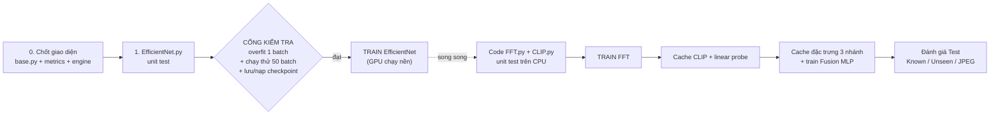

# Chốt cấu hình Bước 5B: 3 nhánh + Fusion MLP

> [!NOTE]
> Môi trường đã kiểm tra trên máy: `torch 2.6.0+cu124`, `torchvision 0.21.0`, **RTX 3050 Laptop 4 GB**, hỗ trợ **bf16**.
> Hiện **chưa cài** `open_clip_torch` (cần cho CLIP) và `scikit-learn` (cần để tính AUC/AP).

---

## 1. Bảng cấu hình tổng hợp

| Hạng mục | Spatial (EfficientNet) | Semantic (CLIP) | Spectral (FFT) |
|---|---|---|---|
| Mô hình | EfficientNet-B0 (`torchvision`) | CLIP ViT-B/16 (OpenAI, `open_clip`) | Residual Spectral CNN **tự thiết kế** |
| Trọng số khởi tạo | ImageNet-1K (`IMAGENET1K_V1`) | WIT-400M (OpenAI) | Ngẫu nhiên (Kaiming) |
| Trạng thái | **Fine-tune toàn bộ** | **Đóng băng 100%** | **Huấn luyện từ đầu** |
| Key lấy từ batch | `batch["spatial"]` | `batch["semantic"]` | `batch["spectral"]` |
| Shape đầu vào | `(B, 3, 224, 224)` | `(B, 3, 224, 224)` | `(B, 1, 224, 224)` |
| View ở Bước 3 | `view_native` (cắt 224, **không resize**) | `view_global` (resize bicubic 224 + center crop) | `view_native` → luma → FFT |
| Chuẩn hóa | Mean/std ImageNet | Mean/std CLIP | log1p + Z-score từng ảnh, DC = 0 |
| **Vector đặc trưng** | **1280 chiều** | **512 chiều** | **256 chiều** |
| Head riêng (train lẻ) | `Dropout(0.2) → Linear(1280, 1)` | `Linear(512, 1)` (linear probe) | `Dropout(0.3) → Linear(256, 1)` |
| Số tham số được train | ≈ 4,0 triệu | 513 | ≈ 4–5 triệu (ước tính) |
| Đầu ra khi train lẻ | logit `(B,)` | logit `(B,)` | logit `(B,)` |

**Fusion MLP:** ghép `1280 + 512 + 256 = 2048` chiều → logit `(B,)`.

**Thiết lập chung khi huấn luyện:** `BCEWithLogitsLoss` với nhãn `batch["label_a"]` (float 0/1); batch đã cân bằng 16:16 nên không cần `pos_weight`; AMP **bf16** (tự kiểm tra GPU, nếu không hỗ trợ thì chuyển sang fp16 + GradScaler); seed 42; `num_workers=4`; gradient clipping `max_norm=1.0`. Chọn checkpoint theo **AUC trên Val (Known)**, với `min_delta=1e-4`; khi AUC hòa thì xét **Balanced Accuracy**. Tuyệt đối không dùng Test để chọn mô hình.

> [!NOTE]
> **Chốt 1 logit + BCE (không dùng 2 logit + CrossEntropy):** với bài toán 2 lớp, hai cách tương đương về mặt toán học, vì softmax của 2 logit chính là sigmoid của hiệu hai logit. Chọn 1 logit vì nó trực tiếp là điểm số để tính AUC và khớp sẵn với `label_a` có shape `(B,)`.
> **Chọn checkpoint theo AUC, Balanced Accuracy dùng để phân xử khi hòa:** Val không cân bằng (1.459 Real : 4.377 AI, tỉ lệ 1:3). Cả AUC lẫn Balanced Accuracy đều miễn nhiễm với tỉ lệ lệch này, còn Accuracy thường thì không (đoán toàn AI vẫn được 75%). AUC được ưu tiên vì không phụ thuộc ngưỡng 0,5. Trên Val Known, AUC của EfficientNet có thể bão hòa ở mức ~0,999, khi đó chênh lệch giữa các epoch chỉ là nhiễu. `min_delta` và quy tắc phân xử bằng Balanced Accuracy xử lý trường hợp này.

---

## 2. Nhánh Spatial: vì sao EfficientNet phải fine-tune

**Quyết định: fine-tune toàn bộ, chia làm 2 pha.**

Lý do không đóng băng: đặc trưng ImageNet được học để nhận diện **vật thể** (chó, xe, ghế…), còn dấu vết AI là **vân/nhiễu mức pixel** (nhiễu upsampling, texture quá mịn). Nếu đóng băng, các lớp sâu sẽ bỏ qua đúng những dấu vết cần tìm. Nhánh CLIP đóng băng được vì nhiệm vụ của nó khác: nó lo phần ngữ nghĩa, và CLIP vốn đã được nhiều nghiên cứu (UnivFD, Ojha và cộng sự, CVPR 2023) chứng minh là tổng quát hóa tốt khi đóng băng.

| Pha | Epoch | Phần được train | Learning rate |
|---|---|---|---|
| A. Khởi động head | 1 | Chỉ head (backbone đóng băng) | head `1e-3` |
| B. Fine-tune | tối đa ~15 | Toàn bộ | backbone `1e-4`, head `1e-3` |

- Pha A tránh việc head khởi tạo ngẫu nhiên đẩy gradient lớn làm hỏng trọng số pretrained ngay ở những batch đầu.
- Dùng AdamW, weight decay `1e-4`, lịch cosine, early stopping (patience 3–4) theo AUC trên Val.
- BatchNorm vẫn để trainable (batch 32 đủ lớn để thống kê ổn định).
- Code có tham số `trainable_stages` (mặc định: toàn bộ). Nếu kết quả trên Val tốt nhưng điểm trên generator Unseen kém, chuyển sang **fine-tune một phần** (chỉ mở 1–2 stage cuối), đúng như ChatGPT đề xuất, và báo cáo như một thí nghiệm ablation. Không cần sửa code.
- Không gọi `weights.transforms()` của torchvision (Resize 256 → CenterCrop 224), vì Bước 4A đã cắt 224 và chuẩn hóa ImageNet.
- Lấy đặc trưng: `features(x)` → `(B, 1280, 7, 7)` → `AdaptiveAvgPool` → `(B, 1280)`.

---

## 3. Nhánh Semantic: CLIP đóng băng + lưu đệm đặc trưng

- Dùng `open_clip.create_model_and_transforms("ViT-B-16", pretrained="openai")`, chỉ lấy phần **visual encoder**, không dùng text encoder và không dùng caption.
- Đặc trưng = đầu ra `encode_image()` (sau lớp projection) = **512 chiều**, chuẩn hóa L2.
- `requires_grad=False` cho mọi tham số, luôn đặt `.eval()` (kể cả khi vòng train gọi `model.train()`).
- **Lưu đệm (cache):** vì backbone không đổi, chỉ cần chạy ViT **một lần** qua `build_extract_loader` cho Train (bản gốc + bản lật), Val và Test, rồi lưu ra file `.pt`. Sau đó train linear probe trên vector 512 chiều mất vài giây mỗi epoch, thay vì vài phút.

> [!WARNING]
> Lưu đệm sẽ bỏ qua augmentation JPEG ngẫu nhiên. Baseline đang để `jpeg_prob=0` nên không ảnh hưởng. Nếu sau này bật `jpeg_prob > 0`, cần lưu thêm bản JPEG hoặc chạy CLIP trực tiếp (online).

---

## 4. Nhánh Spectral: kiến trúc Residual Spectral CNN

| Tầng | Cấu hình | Kích thước đầu ra |
|---|---|---|
| Đầu vào | Phổ log-magnitude + **2 kênh tọa độ** (CoordConv) | `(B, 3, 224, 224)` |
| Stem | Conv3×3 (3→32, **stride 1**) + BN + ReLU, **không MaxPool** | `(B, 32, 224, 224)` |
| Stage 1 | 2 BasicBlock, 64 kênh, stride 2 | `(B, 64, 112, 112)` |
| Stage 2 | 2 BasicBlock, 128 kênh, stride 2 | `(B, 128, 56, 56)` |
| Stage 3 | 2 BasicBlock, 256 kênh, stride 2 | `(B, 256, 28, 28)` |
| Stage 4 | 2 BasicBlock, 256 kênh, stride 2 | `(B, 256, 14, 14)` |
| Pooling | **GAP ‖ GMP** (ghép trung bình và cực đại) | `(B, 512)` |
| Projection | Linear(512→256) + ReLU | **`(B, 256)`** |

Ba điểm khác với CNN ảnh thường, đều có lý do riêng:

1. **Stem stride 1, không MaxPool:** gai tần số của ảnh AI (ví dụ tại tần số Nyquist do upsampling) chỉ rộng **1–2 pixel**. Stem kiểu ResNet (Conv7×7 stride 2 + MaxPool) giảm độ phân giải 4 lần ngay từ đầu, dễ làm nhòe các gai này.
2. **CoordConv (thêm 2 kênh tọa độ x, y ∈ [−1, 1]):** trên ảnh phổ, **vị trí chính là tần số**. Tích chập vốn bất biến với dịch chuyển nên không biết một gai đang nằm ở tần số thấp hay cao. Hai kênh tọa độ được tạo cố định bên trong `forward()`, nên **không cần sửa `dataset.py`**.
3. **GAP ‖ GMP:** Global Average Pooling làm loãng các gai thưa. Global Max Pooling giữ lại tín hiệu mạnh nhất. Ghép cả hai giúp mô hình vừa thấy phân bố năng lượng tổng thể, vừa thấy được gai.

Siêu tham số: AdamW `lr=1e-3`, weight decay `1e-4`, 1 epoch warm-up, lịch cosine, tối đa ~30 epoch (train từ đầu nên cần nhiều epoch hơn), early stopping patience 5.

---

## 5. Fusion MLP

```text
f_spa (1280) ─ LayerNorm(1280) ─┐
f_sem (512)  ─ LayerNorm(512)  ─┼─ [Branch Dropout] ─ concat (2048)
f_spe (256)  ─ LayerNorm(256)  ─┘
   ─ Linear(2048,512) ─ GELU ─ Dropout(0.3) ─ Linear(512,128) ─ GELU ─ Dropout(0.2) ─ Linear(128,1) ─ logit (B,)
```

> [!IMPORTANT]
> **Đề xuất sửa so với bản cũ:** dùng **LayerNorm riêng cho từng nhánh** thay cho một `LayerNorm(2048)` chung. Vector CLIP đã chuẩn hóa L2 nên mỗi chiều chỉ cỡ ±0,04, trong khi đặc trưng EfficientNet lớn hơn nhiều. LayerNorm chung tính mean/std trên cả 2048 chiều, nên 1280 chiều của EfficientNet sẽ chi phối và nhánh CLIP gần như bị "chìm".

- Ba backbone **đóng băng** khi train Fusion. Đặc trưng được lưu đệm ở chế độ eval, gồm bản gốc và bản lật.
- Thêm tầng ẩn 128 (2048 → 512 → 128 → 1) theo đề xuất trùng nhau của Gemini và ChatGPT.
- **Branch dropout là tham số `branch_dropout_p`, mặc định 0 (Fusion cơ bản).** Biến thể p = 0,15, luôn giữ tối thiểu 2 nhánh, chạy như một **thí nghiệm ablation**. Fusion train chỉ mất vài giây nên chạy cả hai rất rẻ. Lý do vẫn cần thử biến thể: EfficientNet đã fine-tune trên chính tập Train nên đặc trưng của nó trên Train gần như tách biệt hoàn toàn, và Fusion có nguy cơ dựa hết vào nhánh này.
- Early stopping theo AUC trên Val.

> [!WARNING]
> Val chỉ chứa generator Known, nên **không đo được** lợi ích của branch dropout trên Unseen. Báo cáo cả hai cấu hình trên Test như một ablation. Không được chọn cấu hình "chính thức" dựa trên điểm Test Unseen, vì như vậy là rò rỉ dữ liệu Test.

---

## 6. Trình tự thống nhất: "chốt giao diện trước, qua cổng kiểm tra rồi train ngay"

> [!NOTE]
> **Số đo thực tế trên máy (06/11):** 1 epoch train = 435 batch.
> - DataLoader nhánh spatial: 0,23 s/batch với 2 worker, **0,06 s/batch với 4 worker** (máy có 12 luồng CPU).
> - GPU EfficientNet-B0 (bf16, batch 32): 0,12 s/batch, VRAM đỉnh 1,46 GB.
> - Suy ra: **khoảng 1–1,5 phút/epoch train**. Train trọn một nhánh mất **dưới 1 giờ**, không phải qua đêm.



**Ba nguyên tắc:**

1. **Chốt giao diện trước khi viết nhánh đầu tiên** (`base.py`: `input_key`, `feature_dim`, `forward_features()`, `forward()`). Mọi nhánh và Fusion đều dựa trên hợp đồng này, nên không có rủi ro phải sửa lại nhánh đã train.
2. **Qua cổng kiểm tra rồi mới train dài:** những lỗi đắt giá nằm ở engine (shape nhãn, metric, checkpoint, `set_epoch`, AMP), không nằm ở file mô hình. Unit test của từng nhánh không phát hiện được các lỗi này; chỉ một lần chạy train thật mới phát hiện được. EfficientNet là mô hình chắc chắn hoạt động, nên dùng nó để kiểm chứng engine.
3. **GPU không bao giờ chờ code:** khi EfficientNet đang train, viết FFT/CLIP và chạy unit test của chúng **trên CPU**. GPU chỉ có 4 GB VRAM, nên không chạy 2 tác vụ GPU cùng lúc.

**Vì sao thứ tự là EfficientNet → FFT → CLIP:**

| Nhánh | Code mô hình | Quy trình train | Giá trị khi làm trước |
|---|---|---|---|
| EfficientNet | Rất dễ (torchvision có sẵn, chỉ thay head) | Chuẩn, dễ kiểm chứng | **Cao nhất**: dùng để dựng và kiểm thử engine với một mô hình "chắc chắn hoạt động". Nếu kết quả tệ, lỗi nằm ở engine/data chứ không phải ở mô hình |
| FFT | Khó nhất (tự thiết kế, train từ đầu) | Dùng lại 100% engine | Chỉ thay class mô hình |
| CLIP | Dễ nhất về số dòng code | **Khác hẳn** (extract cache → probe) | Script extract của nó được tái sử dụng cho Fusion |

CLIP có ít dòng code nhất, nhưng không nên làm đầu tiên: quy trình của nó (lưu đệm rồi probe) không giúp kiểm thử được vòng train end-to-end mà EfficientNet và FFT cần.

---

## 7. "Code một nhánh rồi dùng chung cho cả 3 nhánh" nghĩa là gì

Phần **dùng chung không phải là mạng nơ-ron**, mà là **khung huấn luyện (engine)**. Mỗi nhánh tuân theo cùng một "hợp đồng" (interface):

```python
class BranchBase(nn.Module):
    input_key: str        # "spatial" | "semantic" | "spectral"
    feature_dim: int      # 1280 | 512 | 256
    def forward_features(self, x) -> Tensor:  # (B, feature_dim)  -> dùng cho Fusion
    def forward(self, x) -> Tensor:           # (B,) logit         -> dùng khi train lẻ
```

Nhờ vậy, engine chỉ cần viết **một lần** và không quan tâm bên trong là mô hình nào:

```python
x      = batch[model.input_key].to(device, non_blocking=True)
logits = model(x)
loss   = bce(logits, batch["label_a"].to(device))
```

Đổi nhánh chỉ cần đổi tham số: `train_branch.py --branch spatial` → `--branch spectral`. Loop, AMP, optimizer, scheduler, early stopping, checkpoint, tính AUC/ACC/AP và đánh giá theo từng generator đều giữ nguyên. Fusion cũng chỉ gọi `forward_features()` của cả 3 nhánh.

### Danh sách file cần code

| File | Nội dung |
|---|---|
| `code/system/branch/base.py` | `BranchBase`: `input_key`, `feature_dim`, `forward_features()`, `forward()` → `(B,)`, `count_parameters()`, `freeze_backbone()`. **Không** đặt `no_grad` ở lớp cơ sở |
| `code/system/branch/EfficientNet.py` | `SpatialBranch` + unit test (shape, số tham số, pha A/B, `trainable_stages`) |
| `code/system/branch/FFT.py` | `SpectralBranch` (CoordConv, ResBlock, GAP‖GMP) + unit test trên CPU |
| `code/system/branch/CLIP.py` | `SemanticBranch` (đóng băng, `no_grad` + `.eval()` **chỉ bên trong nhánh này**) + unit test (không có gradient) |
| `code/system/branch/fusion_mlp.py` | `FusionMLP` (LayerNorm từng nhánh, 2048→512→128→1, `branch_dropout_p`, chọn được tập con nhánh) |
| `code/system/train/metrics.py` | AUC, Balanced Acc, AP, ACC@0.5, Precision, Recall, F1, FPR, **tính trên toàn tập** (không lấy trung bình theo batch); đánh giá cặp 1:1 Real với từng generator, macro-average Known/Unseen |
| `code/system/train/engine.py` | `train_one_epoch(max_batches)`, `evaluate()`, `fit()`, `overfit_single_batch_check()`, `EarlyStopping`, `save/load_checkpoint` |
| `code/system/train/train_branch.py` | CLI train lẻ (`--branch spatial|spectral`, `--sanity-check`) |
| `code/system/train/extract_features.py` | Lưu đệm đặc trưng cả 3 nhánh qua `build_extract_loader` (tuần tự, **không** dùng Sampler) |
| `code/system/train/train_fusion.py` | Train Fusion và linear probe CLIP trên đặc trưng đã lưu đệm; ablation 7 tổ hợp nhánh |

> [!TIP]
> Khi train lẻ một nhánh, luôn truyền `active_branches=("spatial",)` (hoặc nhánh tương ứng) vào `build_dataloaders()`. DataLoader sẽ bỏ qua tiền xử lý của 2 nhánh còn lại, giảm đáng kể tải CPU, vốn thường là nút thắt trên laptop.


---

## 8. Nhật ký sửa đổi sau phản biện của Gemini và ChatGPT (07/11)

### 8.1. Các điểm chấp nhận và đưa vào thiết kế

| # | Nội dung | Nguồn | Cách thực hiện |
|---|---|---|---|
| 1 | Cổng kiểm tra overfit 1 batch **không** bắt buộc loss về 0 | ChatGPT | Điều kiện đạt: loss giảm **≥ 90% so với ban đầu** và accuracy trên chính batch đó đạt 100% sau tối đa 100 bước |
| 2 | Kiểm tra checkpoint so sánh **dự đoán**, không chỉ so AUC | ChatGPT | Lưu rồi nạp lại, ở chế độ `eval()`, `allclose(logits_trước, logits_sau)` trên cùng một batch |
| 3 | Engine gọi **tường minh** `train_dataset.set_epoch(epoch)` và `train_sampler.set_epoch(epoch)` | ChatGPT | Cả hai lệnh đều idempotent (gọi lại với cùng epoch không gây hại), nên giữ được `attach_sampler` trong `dataset.py` mà không lo gọi trùng |
| 4 | Không đặt `torch.no_grad()` trong `BranchBase` | ChatGPT | `no_grad` chỉ nằm trong `SemanticBranch.forward_features()` |
| 5 | Ghép đặc trưng 3 nhánh **theo `filepath`/`sample_idx`**, không ngầm định theo thứ tự dòng | ChatGPT | `extract_features.py` lưu kèm `filepath`, `sample_idx`; `train_fusion.py` dùng `assert` để kiểm tra 3 file khớp nhau trước khi `concat` |
| 6 | Trích xuất toàn bộ 27.812 ảnh Train, không dùng `BalancedGroupSampler` | ChatGPT | **Đã có sẵn:** `build_extract_loader` duyệt tuần tự (unit test số 10 của `dataset.py`) |
| 7 | Khi train Fusion vẫn giữ cân bằng 1:1 và augmentation lật | Gemini | `CachedFeatureDataset` dùng lại `BalancedGroupSampler` trên `train_df`. Mỗi mẫu tung đồng xu chọn bản gốc hay bản lật, **đồng bộ cho cả 3 nhánh**. Chỉ số khớp nhau vì `sample_idx` chính là số thứ tự dòng của `train_df` |
| 8 | Checkpoint lưu đủ: model, optimizer, scheduler, scaler (`None` khi dùng bf16), epoch, best metric, config | ChatGPT, Gemini | `save_checkpoint()` trong `engine.py` |
| 9 | Tự kiểm tra GPU có hỗ trợ bf16 không, nếu không thì dùng fp16 + GradScaler | ChatGPT | `engine.py` |
| 10 | Gradient clipping `max_norm=1.0`; `max_batches` cho cổng kiểm tra | Gemini | `train_one_epoch()` |
| 11 | Unit test của FFT/CLIP chạy trên CPU và **giới hạn số luồng CPU** khi GPU đang train | Gemini, ChatGPT | Dùng `torch.set_num_threads(2)` để không tranh CPU với 4 worker của DataLoader |
| 12 | Fusion thêm tầng ẩn 128 | Gemini, ChatGPT | 2048 → 512 → 128 → 1 |
| 13 | Metric tính trên toàn tập, không lấy trung bình theo batch | ChatGPT | `evaluate()` gom toàn bộ logits rồi mới gọi `metrics.py` |
| 14 | JPEG robustness là một lượt đánh giá riêng, báo cáo riêng | ChatGPT | `build_extract_loader("test", fixed_jpeg_quality=q)` với q ∈ {90, 70, 50, 30} |
| 15 | Đánh giá cặp 1:1 dùng lại cùng 7.300 ảnh Real: báo cáo từng generator và macro-average, **không** coi 5 cặp là 5 tập quan sát độc lập | ChatGPT | Ghi chú phương pháp trong Chương 4 |
| 16 | Ablation 7 tổ hợp nhánh | Gemini | `train_fusion.py --branches ...`. Mọi tổ hợp dùng **cùng loại head, cùng quy trình train** để so sánh công bằng. Kết quả từ head riêng của từng nhánh được báo cáo thêm |

### 8.2. Các điểm có điều chỉnh hoặc không theo hoàn toàn

| Đề xuất | Nguồn | Quyết định | Lý do |
|---|---|---|---|
| Dùng Balanced Accuracy làm metric **chính** để chọn checkpoint | ChatGPT | **Giữ AUC làm metric chính**; Balanced Accuracy dùng để phân xử khi AUC hòa (`min_delta=1e-4`) | Cả hai đều miễn nhiễm với tỉ lệ 1:3. AUC không phụ thuộc ngưỡng. Khi chuyển sang generator Unseen, phân phối điểm số thường bị dịch, nên ngưỡng 0,5 không còn tối ưu, còn AUC vẫn phản ánh đúng khả năng tách lớp |
| Branch dropout bật mặc định với p = 0,15 | Gemini | **Mặc định tắt (p = 0)**, chạy biến thể p = 0,15 như ablation | Theo ChatGPT: đường cơ sở sạch trước, cải tiến sau. Lập luận "tăng vọt trên Unseen" của Gemini là giả thuyết, chưa được kiểm chứng |
| Branch dropout "chỉ thử sau" | ChatGPT | Code sẵn tham số ngay từ đầu | Chi phí bằng 0, Fusion train chỉ mất vài giây |
| CLIP train qua `train_branch.py --branch semantic` | Gemini | Linear probe CLIP được train trong `train_fusion.py --branches semantic --head linear` trên đặc trưng đã lưu đệm | Không cần viết nhánh xử lý riêng cho CLIP trong engine; `train_branch.py` chỉ phục vụ spatial và spectral |
| Kiểm tra "3 epoch phủ đủ 3 ảnh AI mỗi group" ở cổng kiểm tra | ChatGPT | Không lặp lại | **Đã được kiểm thử** trong unit test của `balance_sample.py` |

### 8.3. Việc cần làm trước khi code

- [x] Cài `scikit-learn` (cho AUC/AP) vào `venv` (Đã cài & hoạt động).
- [ ] Cài `open_clip_torch` (cho CLIP) vào `venv` khi triển khai nhánh Semantic.

---

## 9. Bảng thông số kỹ thuật chi tiết phục vụ báo cáo: Nhánh Spatial (EfficientNet-B0 Baseline)

> [!NOTE]
> Mục này ghi lại toàn bộ thông số thực nghiệm chính thức đã được kiểm chứng qua Cổng kiểm tra 3 bước (`--sanity-only` đạt 100% PASS trên card RTX 3050 Laptop ngày 09/11/2026). Dùng làm dữ liệu gốc để trích dẫn vào Chương 3 (Phương pháp đề xuất) và Chương 4 (Thực nghiệm & Đánh giá) của Đồ án tốt nghiệp.

### 9.1. Kiến trúc mạng và Phân bổ tham số (Model Architecture)
* **Khung xương (Backbone):** `EfficientNet-B0` (chuẩn `torchvision.models.efficientnet_b0`, bản quyền ImageNet-1K V1).
* **Đầu vào (Input Shape):** `(B, 3, 224, 224)` với `input_key = "spatial"`, trích xuất trực tiếp từ `view_native` (cắt $224 \times 224$ nguyên pixel gốc, không qua nội suy bicubic/bilinear nhằm bảo tồn toàn vẹn tạo tác tần số cao và nhiễu vi mô).
* **Chuẩn hóa (Normalization):** Chuẩn ImageNet (Mean: `[0.485, 0.456, 0.406]`, Std: `[0.229, 0.224, 0.225]`).
* **Đầu phân loại (Classifier Head):** Thay thế hoàn toàn lớp 1.000 lớp ban đầu bằng:
  $$\text{Classifier}(f) = \text{Linear}(1280 \to 1) \circ \text{Dropout}(p=0.2)$$
* **Phân bổ tham số chi tiết:**
  - Tổng số tham số mô hình: **`4,008,829` tham số**.
  - Phần thân Backbone: **`4,007,548` tham số** (gồm 9 stage: stage 0 là Stem Conv3×3; stages 1–7 là các khối MBConv; stage 8 là Conv1×1 chuyển kênh lên 1280).
  - Phần đầu Classifier: **`1,281` tham số** (Weight: $1 \times 1280$, Bias: $1$).

### 9.2. Chiến lược Huấn luyện 2 Pha Vi sai (Two-Phase Differential Fine-Tuning)
Mô hình giải quyết triệt để xung đột giữa đặc trưng cấp cao ImageNet và tạo tác pixel của ảnh AI thông qua 2 pha liên tục (tổng cộng 16 epochs, chỉ số epoch liên tục `0 .. 15` để `BalancedGroupSampler` không bị đứt chu kỳ xoay vòng dữ liệu):

| Thuộc tính | Pha A: Khởi động Head (Warmup Head) | Pha B: Tinh chỉnh Toàn phần (Full Fine-tuning) |
| :--- | :--- | :--- |
| **Khoảng Epoch** | **Epoch 0** (1 epoch) | **Epochs 1 .. 15** (15 epochs) |
| **Vùng tham số học** | Chỉ `classifier` (**1,281 tham số**) | Mở khóa toàn bộ Backbone + Head (**4,008,829 tham số**) |
| **Trạng thái Backbone** | **Khóa cứng tuyệt đối:** `requires_grad=False`, khóa toàn bộ 49 lớp `BatchNorm2d` ở chế độ `.eval()` và 16 tầng `StochasticDepth` ở chế độ `.eval()` (drop_path = 0). | Mở khóa theo `trainable_stages="all"`. Các tầng BatchNorm2d được cập nhật thống kê running stats phù hợp với phân phối ảnh AI. |
| **Thuật toán Tối ưu** | `AdamW` (1 param_group: `head`) | `AdamW` (tạo mới hoàn toàn với 2 param_groups: `backbone` và `head`) |
| **Tốc độ học (LR)** | $\text{head\_lr} = 1.0 \times 10^{-3}$ | $\text{backbone\_lr} = 1.0 \times 10^{-4}$ (chậm hơn 10 lần) <br> $\text{head\_lr} = 1.0 \times 10^{-3}$ |
| **Lịch trình LR (Scheduler)**| Không dùng (`None`) | `CosineAnnealingLR` với $T_{\max} = 15$, hạ từ $10^{-4} \to \eta_{\min} = 10^{-6}$ |
| **Chuyển giao trạng thái** | Lấy trọng số Classifier tốt nhất Pha A nạp sang Pha B | Tiếp tục tích lũy chỉ số trên cùng bộ điều khiển `EarlyStopping` |

### 9.3. Tối ưu hóa, Hàm mất mát và Tiêu chí Kiểm định
* **Hàm mất mát (Loss):** `BCEWithLogitsLoss()` trên 1 logit đầu ra `(B,)` kết hợp nhãn thực `batch["label_a"]` dạng nhị phân (`0.0` = Real, `1.0` = AI). Không cần `pos_weight` vì mỗi batch luôn được cân bằng đúng 16 Real : 16 AI.
* **Cắt tỉa Gradient (Gradient Clipping):** `max_norm = 1.0` theo chuẩn $L_2$ để kiểm soát độ ổn định khi mở khóa backbone.
* **Suy giảm trọng số (Weight Decay):** $1.0 \times 10^{-4}$ cho cả 2 pha.
* **Chiến lược Dừng sớm (Early Stopping):**
  - Số epoch kiên nhẫn (`patience`): **4 epochs**.
  - Ngưỡng tiến bộ tối thiểu (`min_delta`): **$1.0 \times 10^{-4}$ ($0.0001$)**.
  - Chỉ số mục tiêu chính (`primary_metric`): **`AUC` trên tập Validation Known (5.836 ảnh)**.
  - Phân xử hòa (`secondary_metric`): **`Balanced Accuracy`** (khi chênh lệch AUC $\le 10^{-4}$, mô hình có Balanced Accuracy cao hơn sẽ giành quyền lưu checkpoint `best_spatial.pth`).
  - **Nguyên tắc bảo vệ:** Tuyệt đối không dùng tập Test để chọn checkpoint hay điều chỉnh siêu tham số.

### 9.4. Dữ liệu và Thiết lập Nạp dữ liệu (Dataset & DataLoader)
* **Kích thước Lô (Batch Size):** `batch_size = 32` (Train: 16 Real MS-COCO : 16 AI), `eval_batch_size = 32`.
* **Bộ chọn mẫu (Sampler):** `BalancedGroupSampler` xoay vòng đều đặn 100% kho dữ liệu AI qua chu kỳ 3 epochs.
* **Cấu hình Đa tiến trình trên Windows:**
  - `num_workers = 2` cho Train Loader kèm `persistent_workers = True` (giữ tiến trình sống liên tục, tránh nghẽn I/O và triệt tiêu độ trễ spawn tiến trình của Windows).
  - `eval_workers = 2` cho Val Loader và Test Loader kèm `persistent_workers = False` (tự giải phóng bộ nhớ ảo ngay sau khi đánh giá xong).
* **Độ tất định và Tái lập (Determinism & Reproducibility):**
  - Cố định hạt giống: `seed = 42`.
  - Đồng bộ chu kỳ `epoch` qua bộ nhớ dùng chung (Shared Memory) của `CommonProcess`, bảo đảm bộ sinh số ngẫu nhiên lật ảnh được tái tạo chuẩn xác $100\%$ kể cả khi Resume.

### 9.5. Phần cứng, Tối ưu Bộ nhớ và Tệp Xuất xưởng
* **Phần cứng thực thi:** NVIDIA GeForce RTX 3050 Laptop GPU (4 GB VRAM, kiến trúc Ampere).
* **Tự động chuyển đổi kiểu số (AMP):** Kích hoạt Native Mixed Precision với `dtype = torch.bfloat16` (dải động số mũ tương đương FP32, loại bỏ hoàn toàn nguy cơ tràn số Underflow/Overflow mà không cần dùng `GradScaler`).
* **Vị trí lưu trữ Checkpoints và Báo cáo:**
  - Thư mục làm việc: `code/system/checkpoints/spatial_baseline/`
  - Tệp Checkpoint tốt nhất: `best_spatial.pth` (dùng cho suy luận và trích xuất đặc trưng phục vụ Fusion).
  - Tệp Checkpoint gần nhất: `last_spatial.pth` (chứa trọn vẹn trạng thái Model, Optimizer, Scheduler, EarlyStopping, RNG và `dataset_manifest_hash` để Resume tự thân).
  - Tệp Lịch sử: `history_spatial.json` (lưu chi tiết Loss, AUC, Bal-ACC, AP, Accuracy và ma trận nhầm lẫn theo từng epoch).

### 9.6. Kết quả Huấn luyện Chính thức & Độ chính xác trên Tập Validation (5,836 ảnh Known)

* **Thông tin phiên chạy:** `run_id = spatial_baseline_1794239311_88f832` | Hoàn tất toàn bộ **16 epochs (`0..15`)** không kích hoạt EarlyStopping | Tổng thời gian: **`2,257.23 giây` ($\approx 37.6$ phút)** | Checkpoint tốt nhất: **`best_spatial.pth` (Epoch 15)**.

#### Diễn biến quá trình huấn luyện theo các mốc tiêu biểu:
| Epoch | Pha | LR (Backbone / Head) | Train Loss | Train AUC | Val Loss | Val AUC | Val Bal-ACC | SD 2.1 AUC | SDXL AUC | DALL-E 3 AUC | Ghi chú |
| :---: | :---: | :---: | :---: | :---: | :---: | :---: | :---: | :---: | :---: | :---: | :--- |
| **00** | A (Warmup) | `—` / `1.00e-3` | `0.4865` | `0.8609` | `0.4593` | `0.8855` | `80.52%` | `0.8332` | `0.8656` | `0.9577` | Chỉ học 1,281 params Head |
| **01** | B (Finetune) | `1.00e-4` / `1.00e-3` | `0.1972` | `0.9763` | `0.1113` | `0.9917` | `95.86%` | `0.9827` | `0.9957` | `0.9968` | Mở khóa toàn mạng, AUC tăng +10.6% |
| **03** | B (Finetune) | `9.57e-5` / `9.57e-4` | `0.0986` | `0.9942` | `0.0841` | `0.9946` | `96.97%` | `0.9893` | `0.9966` | `0.9979` | Tiếp tục lập đỉnh mới |
| **06** | B (Finetune) | `7.52e-5` / `7.50e-4` | `0.0708` | `0.9972` | `0.0576` | `0.9972` | `98.05%` | `0.9949` | `0.9979` | `0.9986` | Val Bal-ACC vượt mốc 98% |
| **10** | B (Finetune) | `3.52e-5` / `3.46e-4` | `0.0514` | `0.9984` | `0.0515` | `0.9979` | `97.97%` | `0.9958` | `0.9985` | `0.9995` | Hội tụ ổn định |
| **14** | B (Finetune) | `5.30e-6` / `4.42e-5` | `0.0387` | `0.9990` | `0.0482` | `0.9983` | `98.33%` | `0.9966` | `0.9989` | `0.9994` | Val Bal-ACC cao nhất (`98.33%`) |
| **15** | **B (Best)** | `2.10e-6` / `1.19e-5` | **`0.0372`** | **`0.9992`** | **`0.0461`** | **`0.9985`** | **`98.22%`** | **`0.9970`** | **`0.9991`** | **`0.9995`** | **★ Lưu `best_spatial.pth`** |

#### Độ chính xác cuối cùng trên Validation Known (`1,459` Real vs `4,377` AI) tại `best_spatial.pth`:
* **Chỉ số tổng thể (Overall):**
  - **ROC-AUC:** **`0.9985`** | **AP (PR-AUC):** **`0.9995`** | **Val BCE Loss:** **`0.0461`**
  - **Balanced Accuracy:** **`98.22%`** | **Accuracy:** **`98.46%`** | **F1-Score:** **`0.9897`**
  - **Precision:** **`99.24%`** | **Recall:** **`98.70%`** | **FPR:** **`2.26%`**
  - **Ma trận nhầm lẫn:** `TP = 4,320` | `FP = 33` | `TN = 1,426` | `FN = 57`
  - **Phân tách xác suất trung bình:** $P(\text{AI}|\text{Real}) = \mathbf{0.0235}$ vs. $P(\text{AI}|\text{AI}) = \mathbf{0.9849}$
* **Chi tiết theo từng Generator (Cặp 1:1 với 1,459 ảnh Real `MS_COCO`):**
  | Generator (Known) | AUC | Balanced ACC | AP | F1 | Recall | FPR | $P(\text{AI}|\text{AI})$ | TP / FN |
  | :--- | :---: | :---: | :---: | :---: | :---: | :---: | :---: | :---: |
  | `Stable_Diffusion_2.1` | `0.9970` | `97.40%` | `0.9971` | `0.9739` | `97.05%` | `2.26%` | `0.9699` | `1,416 / 43` |
  | `Stable_Diffusion_XL` | `0.9991` | `98.63%` | `0.9990` | `0.9864` | `99.52%` | `2.26%` | `0.9918` | `1,452 / 7` |
  | `DALL-E_3` | `0.9995` | `98.63%` | `0.9995` | `0.9864` | `99.52%` | `2.26%` | `0.9932` | `1,452 / 7` |
  | **Macro-Avg Known (3 models)** | **`0.9985`** | **`98.22%`** | **`0.9985`** | **`0.9822`** | **`98.70%`** | **`2.26%`** | — | — |

> [!NOTE]
> Tập Test (`43,800` ảnh gồm cả 2 Unseen models `Stable_Diffusion_3` và `Midjourney_V6`) chưa được mở đánh giá ở bước này nhằm giữ tính khách quan tuyệt đối cho đến khi hoàn thiện toàn bộ 3 nhánh và hệ thống Fusion.

---

## 10. Bảng thông số kỹ thuật chi tiết phục vụ báo cáo: Nhánh Spectral (Residual Spectral CNN)

> [!NOTE]
> Mục này ghi lại toàn bộ thông số thực nghiệm chính thức đã được kiểm chứng qua Cổng kiểm tra 3 bước (`--sanity-only` đạt 100% PASS trên card RTX 3050 Laptop ngày 10/11/2026). Dùng làm dữ liệu gốc để trích dẫn vào Chương 3 và Chương 4 của Đồ án tốt nghiệp.

### 10.1. Kiến trúc mạng và Phân bổ tham số (Model Architecture)
* **Khung xương (Backbone):** `Residual Spectral CNN` tự thiết kế chuyên biệt cho bản đồ phổ tần số 2D Fourier (huấn luyện từ đầu, Train from scratch).
* **Đầu vào (Input Shape):** `(B, 1, 224, 224)` với `input_key = "spectral"`, trích xuất trực tiếp từ `view_native` (cắt $224 \times 224$ nguyên pixel gốc $\to$ Luma $Y'$ $\to$ 2D FFT $\to$ Dịch tâm DC về giữa $\to$ $\log(1 + |F|) \to$ Chuẩn hóa Instance Z-score với `remove_dc=True` triệt tiêu thành phần DC để chống học vẹt độ sáng trung bình).
* **Cơ chế CoordConv:** Tự động sinh 2 kênh tọa độ không gian chuẩn hóa $x, y \in [-1, 1]$ ghép vào kênh phổ thành Tensor 3 kênh `(B, 3, 224, 224)`, giúp mạng CNN vượt qua tính bất biến tịnh tiến và nhận biết chính xác vị trí tần số (tâm: tần số thấp, rìa: tần số cao). Hỗ trợ sinh lưới động nếu đầu vào khác $224 \times 224$.
* **Tầng Stem:** `Conv2d(3, 32, k=3, s=1, p=1, bias=False) + BatchNorm2d(32) + ReLU`. Giữ nguyên độ phân giải $224 \times 224$ (`stride=1`, không `MaxPool`) nhằm bảo toàn nguyên vẹn các gai năng lượng AI siêu hẹp (kích thước $1 \times 1$ pixel).
* **Thân mạng 4 Residual Stages:** Gồm 8 khối `SpectralBasicBlock`:
  - Stage 1: $(32, 224, 224) \to (64, 112, 112)$ (2 BasicBlocks, stride=2 ở block đầu).
  - Stage 2: $(64, 112, 112) \to (128, 56, 56)$ (2 BasicBlocks, stride=2 ở block đầu).
  - Stage 3: $(128, 56, 56) \to (256, 28, 28)$ (2 BasicBlocks, stride=2 ở block đầu).
  - Stage 4: $(256, 28, 28) \to (256, 14, 14)$ (2 BasicBlocks, stride=2 ở block đầu; downsample shortcut kích hoạt chuẩn xác dù kênh vào/ra đều là 256).
* **Gom đặc trưng kép (Dual Spectral Pooling):** Ghép nối `AdaptiveAvgPool2d(1)` (bắt độ dốc phổ năng lượng $1/f^\alpha$) và `AdaptiveMaxPool2d(1)` (bắt các đỉnh xung gai cực đại) $\to$ vector ghép 512 chiều.
* **Tầng chiếu (Projection):** `Linear(512 -> 256) + LayerNorm(256) + GELU` $\to$ xuất ra vector đặc trưng chuẩn **`256 chiều`** phục vụ Fusion MLP.
* **Đầu phân loại (Classifier Head):** `Dropout(p=0.3) + Linear(256 -> 1)` xuất ra 1 logit `(B,)` phục vụ hàm mất mát `BCEWithLogitsLoss`.
* **Phân bổ tham số chi tiết (Chuẩn xác 100%):**
  - Tầng Stem: **`928` tham số**
  - Stage 1: **`131,712` tham số**
  - Stage 2: **`525,568` tham số**
  - Stage 3: **`2,099,712` tham số**
  - Stage 4: **`2,427,392` tham số**
  - Tầng Projection: **`131,840` tham số**
  - Thân mạng (Backbone): **`5,317,152` tham số**
  - Đầu phân loại (Classifier Head): **`257` tham số** (Weight: $1 \times 256$, Bias: $1$)
  - **TỔNG SỐ THAM SỐ TOÀN MÔ HÌNH: `5,317,409` tham số**.

### 10.2. Khởi tạo Trọng số & Cơ chế Zero-Init Residual
* **Khởi tạo cơ sở:**
  - `nn.Conv2d`: Kaiming Normal (`mode='fan_out'`, `nonlinearity='relu'`), bảo toàn phương sai đạo hàm chiều ngược qua các khối tích chập ReLU.
  - `nn.Linear`: Kaiming Normal (`mode='fan_in'`, `nonlinearity='linear'`), bảo toàn phương sai chiều xuôi ($\sigma_w = 1/\sqrt{\text{fan\_in}}$), ngăn chặn triệt để hiện tượng bùng nổ logit tại tầng phân loại `Linear(256, 1)` (nơi `fan_out = 1`) và giữ `Initial BCE Loss` sát mốc lý thuyết $\ln(2) \approx 0.6931$.
  - `nn.BatchNorm2d` & `nn.LayerNorm`: `constant_(1.0)` cho weight và `constant_(0.0)` cho bias.
* **Zero-Init Residual:** Đặt duy nhất `bn2.weight = 0.0` của mỗi `SpectralBasicBlock` (không đặt nhầm các BN khác). Tại bước đầu tiên ($t=0$), nhánh residual tạm thời truyền giá trị 0 qua đường shortcut, giúp gradient truyền ngược ổn định tuyệt đối và mô hình học mượt mà từ những batch đầu tiên.

### 10.3. Kết quả Thực nghiệm Cổng Kiểm Tra 3 Bước (Sanity Check Gate)
* **Phần cứng thực thi:** NVIDIA GeForce RTX 3050 Laptop GPU (4 GB VRAM), Mixed Precision `torch.bfloat16`.
* **Bước 1/3 (Khả năng Overfit trên 1 batch 32 ảnh):**
  - Khởi tạo: Loss = $0.7240$ ($\approx \ln 2 = 0.6931$).
  - Sau 34/100 bước: Loss = $0.0611$ (Loss giảm $91.6\% \ge 90\%$), Post-step Accuracy = **$100.0\%$**. $\implies$ **ĐẠT (PASS)**.
* **Bước 2/3 (Chạy thử 50 batches Train + Val):**
  - Tốc độ huấn luyện Train: **$10.0$ giây / 50 batches** ($0.200$ s/batch bao gồm DataLoader I/O + 2D FFT).
  - Kết quả sau 50 batches: Train Loss = $0.6758$ | Val Loss = $0.6026$, Val AUC = **$0.7056$**, Bal-ACC = **$63.76\%$**.
  - Mức chiếm dụng bộ nhớ VRAM thực tế: **Đỉnh chỉ `0.70 GB`** (hoàn toàn an toàn trên card 4GB VRAM). $\implies$ **ĐẠT (PASS)**.
* **Bước 3/3 (Kiểm tra lưu/nạp Checkpoint & Self-Contained Resume):**
  - Sai số dự đoán tối đa trước và sau khi nạp: **$0.00\text{e}+00$**.
  - Khôi phục tự thân tại `epoch=2` (Opt/Sched/Scaler/EarlyStop/RNG): Sai số bước tiếp theo = **$0.00\text{e}+00$**. $\implies$ **ĐẠT (PASS)**.
* **Đánh giá tổng thể:** Cổng kiểm tra vượt qua **100%**. Mô hình sẵn sàng để huấn luyện chính thức 30 epochs qua lệnh:
  `python code/system/train/train_branch.py --branch spectral`

### 10.4. Kết quả Huấn luyện Chính thức (30 Epochs) & Độ chính xác trên Tập Validation (5,836 ảnh Known)

* **Thông tin phiên chạy:** `run_id = spectral_baseline_1794414851_97fb41` | Thư mục lưu: `code/system/checkpoints/spectral_baseline/` | Hoàn tất toàn bộ **30 epochs (`0..29`)** không kích hoạt EarlyStopping (`patience=5`) | Tổng thời gian: **`4,360.30 giây` ($\approx 72.7$ phút)** | Checkpoint tốt nhất: **`best_spectral.pth` (Epoch 29)**.
* **Lịch trình tối ưu hóa:** `AdamW` ($\text{lr} = 10^{-3}$, $\text{weight\_decay} = 10^{-4}$), 1 epoch Linear Warmup (`0.0001`) + 29 epochs `CosineAnnealingLR` ($10^{-3} \to 3.93 \times 10^{-6}$).

#### Diễn biến quá trình huấn luyện theo các mốc tiêu biểu (Train from scratch):
| Epoch | Pha & LR | Train Loss | Train AUC | Val Loss | Val AUC | Val Bal-ACC | SD 2.1 AUC | SDXL AUC | DALL-E 3 AUC | Ghi chú |
| :---: | :---: | :---: | :---: | :---: | :---: | :---: | :---: | :---: | :---: | :--- |
| **00** | Warmup (`1.00e-4`) | `0.6300` | `0.6965` | `0.5546` | `0.7609` | `68.54%` | `0.8037` | `0.8942` | `0.5848` | Khởi động ổn định từ Initial Loss ~0.69 |
| **01** | Cosine (`1.00e-3`) | `0.5860` | `0.7566` | `0.4081` | `0.8594` | `79.38%` | `0.8115` | `0.8918` | `0.8750` | DALL-E 3 nhảy vọt +0.29 AUC |
| **02** | Cosine (`9.97e-4`) | `0.4263` | `0.8835` | `0.5331` | `0.9097` | `80.77%` | `0.8682` | `0.9196` | `0.9414` | Val AUC vượt mốc 0.90 ngay ở Epoch 2 |
| **05** | Cosine (`9.54e-4`) | `0.3088` | `0.9396` | `0.4496` | `0.9460` | `84.83%` | `0.9162` | `0.9486` | `0.9730` | Bắt trọn đặc trưng phổ DALL-E 3 (>0.97) |
| **08** | Cosine (`8.63e-4`) | `0.2624` | `0.9567` | `0.2402` | `0.9604` | `89.67%` | `0.9354` | `0.9544` | `0.9914` | Val AUC vượt 0.96 |
| **12** | Cosine (`6.85e-4`) | `0.2297` | `0.9669` | `0.2567` | `0.9706` | `90.40%` | `0.9493` | `0.9688` | `0.9936` | Val AUC vượt 0.97, Bal-ACC > 90% |
| **20** | Cosine (`2.67e-4`) | `0.1995` | `0.9753` | `0.2335` | `0.9768` | `91.32%` | `0.9611` | `0.9734` | `0.9960` | Cả 3 generator đều vượt mốc 0.96 |
| **24** | Cosine (`1.03e-4`) | `0.1792` | `0.9800` | **`0.1622`** | `0.9791` | `91.70%` | `0.9644` | `0.9766` | `0.9961` | Val Loss thấp nhất (`0.1622`) |
| **27** | Cosine (`2.71e-5`) | `0.1735` | `0.9813` | `0.1859` | `0.9790` | **`92.40%`** | `0.9652` | `0.9758` | `0.9961` | Val Bal-ACC cao nhất (`92.40%`) |
| **29** | **Cosine (`3.93e-6`)** | **`0.1733`** | **`0.9814`** | `0.1854` | **`0.9794`** | **`92.32%`** | **`0.9650`** | **`0.9771`** | **`0.9961`** | **★ Lưu `best_spectral.pth` (Kỷ lục AUC)** |

#### Độ chính xác cuối cùng trên Validation Known (`1,459` Real vs `4,377` AI) tại `best_spectral.pth`:
* **Chỉ số tổng thể (Overall):**
  - **ROC-AUC:** **`0.9794`** | **AP (PR-AUC):** **`0.9926`** | **Val BCE Loss:** **`0.1854`**
  - **Balanced Accuracy:** **`92.32%`** | **Accuracy:** **`92.84%`** | **F1-Score:** **`0.9513`**
  - **Precision:** **`96.99%`** | **Recall:** **`93.35%`** | **FPR:** **`8.70%`**
  - **Ma trận nhầm lẫn:** `TP = 4,086` | `FP = 127` | `TN = 1,332` | `FN = 291`
  - **Phân tách xác suất trung bình:** $P(\text{AI}|\text{Real}) = \mathbf{0.1029}$ vs. $P(\text{AI}|\text{AI}) = \mathbf{0.8903}$
* **Chi tiết theo từng Generator (Cặp 1:1 với 1,459 ảnh Real `MS_COCO`):**
  | Generator (Known) | AUC | Balanced ACC | AP | F1 | Recall | FPR | $P(\text{AI}|\text{AI})$ | TP / FN |
  | :--- | :---: | :---: | :---: | :---: | :---: | :---: | :---: | :---: |
  | `Stable_Diffusion_2.1` | `0.9650` | `89.55%` | `0.9633` | `0.8936` | `87.80%` | `8.70%` | `0.8218` | `1,281 / 178` |
  | `Stable_Diffusion_XL` | `0.9771` | `92.43%` | `0.9742` | `0.9251` | `93.56%` | `8.70%` | `0.8674` | `1,365 / 94` |
  | `DALL-E_3` | `0.9961` | `95.00%` | `0.9966` | `0.9518` | `98.70%` | `8.70%` | `0.9817` | `1,440 / 19` |
  | **Macro-Avg Known (3 models)** | **`0.9794`** | **`92.32%`** | **`0.9781`** | **`0.9235`** | **`93.35%`** | **`8.70%`** | — | — |

---

## 11. Bảng thông số kỹ thuật chi tiết phục vụ báo cáo: Nhánh Semantic (CLIP ViT-B/16 Linear Probe)

> [!NOTE]
> Mục này ghi lại toàn bộ thông số thực nghiệm chính thức của nhánh thứ 3 (`CLIP.py` + `LinearProbeHead`) đã được huấn luyện trên Feature Cache đóng băng ngày 17/11/2026 (`train_fusion.py --mode probe --sanity-check`). Dùng làm dữ liệu gốc trích dẫn vào Chương 3 và Chương 4 của Đồ án tốt nghiệp.

### 11.1. Kiến trúc mạng và Phân bổ tham số (Model Architecture)
* **Khung xương (Backbone):** `OpenAI CLIP ViT-B/16` (`open_clip 4.2.1`, trọng số `pretrained="openai"`, kích hoạt `QuickGELU=True`), loại bỏ hoàn toàn Text Encoder và chỉ giữ Visual Encoder (`self.visual`).
* **Trạng thái Backbone:** **Đóng băng 100%** (`requires_grad=False`, luôn khóa ở `.eval()`). Đặc trưng được trích xuất một lần và lưu đệm (Feature Cache) gồm `27,812` ảnh Train (cả bản gốc & lật ngang) và `5,836` ảnh Val.
* **Đầu vào (Input Shape):**
  - Đưa vào Backbone: `(B, 3, 224, 224)` với `input_key = "semantic"` từ `view_global` (Shortest-Edge Resize `224` Bicubic $\to$ CenterCrop `224` $\to$ Chuẩn hóa `CLIP_MEAN` / `CLIP_STD`).
  - Vector đặc trưng đầu ra: **`512` chiều**, được ép `float32` và **chuẩn hóa $L_2$** về siêu cầu đơn vị ($\|f\|_2 = 1.0$).
* **Đầu phân loại (Linear Probe Head):** `Dropout(p=0.0) -> Linear(512 -> 1, bias=True)` xuất 1 logit `(B,)` theo phương pháp UnivFD (Ojha et al., CVPR 2023).
* **Phân bổ tham số chi tiết:**
  - Phần thân Backbone (`ViT-B/16 visual`): **`86,192,640` tham số** (đóng băng, không train).
  - Phần đầu Linear Probe (`LinearProbeHead`): **`513` tham số** học được (Weight: $1 \times 512$, Bias: $1$).
  - **Tổng số tham số toàn nhánh (`SemanticBranch`):** **`86,193,153` tham số** (chỉ train **`513` tham số**).

### 11.2. Chiến lược Huấn luyện trên Feature Cache & Tối ưu hóa
* **Thông tin phiên chạy:** `run_id = semantic_probe_1794853676_157e40` | Thư mục lưu: `code/system/checkpoints/stage2/semantic_probe/` & bản chuẩn notebook `code/system/checkpoints/semantic_baseline/best_semantic.pth`.
* **Dữ liệu & Cân bằng lô:** Train trên `27,812` mẫu Feature Cache với `BalancedGroupSampler` (`13,906` mẫu/epoch cân bằng 1:1 = 16 Real : 16 AI, `batch_size=32`), đồng bộ lật ngang `flip_prob=0.5`, `num_workers=0` (đọc trực tiếp trên RAM), `seed=42`.
* **Tối ưu hóa:** `AdamW` (`lr = 1.0e-3`, `weight_decay = 1.0e-4` cho weight, `0.0` cho bias), `warmup_epochs = 0`, lịch `CosineAnnealingLR(T_max=30)`, Gradient Clipping `max_norm = 1.0`, AMP `torch.bfloat16`.
* **Thời gian & Hội tụ:** Hoàn tất trọn **30 epochs (`0..29`)** không kích hoạt EarlyStopping (`patience=6`) trong **`113.25 giây`** ($\approx 1.89$ phút) | Checkpoint tốt nhất: **`best_semantic.pth` (Epoch 24)**.

#### Diễn biến quá trình huấn luyện theo các mốc tiêu biểu:
| Epoch | LR | Train Loss | Train AUC | Val Loss | Val AUC | Val Bal-ACC | SD 2.1 AUC | SDXL AUC | DALL-E 3 AUC | Ghi chú |
| :---: | :---: | :---: | :---: | :---: | :---: | :---: | :---: | :---: | :---: | :--- |
| **00** | `1.00e-3` | `0.5583` | `0.9757` | `0.4593` | `0.9881` | `94.19%` | `0.9721` | `0.9929` | `0.9993` | Ngay Epoch 0 AUC đạt `0.9881` |
| **02** | `9.89e-4` | `0.3096` | `0.9902` | `0.2817` | `0.9913` | `95.48%` | `0.9793` | `0.9954` | `0.9991` | Val AUC vượt mốc `0.99` |
| **05** | `9.33e-4` | `0.1989` | `0.9928` | `0.1885` | `0.9933` | `95.97%` | `0.9840` | `0.9967` | `0.9991` | Tăng trưởng đều ở cả 3 generator |
| **10** | `7.50e-4` | `0.1400` | `0.9945` | `0.1379` | `0.9948` | `96.65%` | `0.9877` | `0.9977` | `0.9991` | Bal-ACC vượt `96.6%` |
| **15** | `5.01e-4` | `0.1155` | `0.9960` | `0.1204` | `0.9955` | `96.93%` | `0.9894` | `0.9981` | `0.9991` | Tiệm cận bão hòa |
| **20** | `2.51e-4` | `0.1091` | `0.9960` | `0.1117` | `0.9959` | `96.98%` | `0.9902` | `0.9983` | `0.9991` | Hội tụ ổn định |
| **24** | **`9.64e-5`** | **`0.1041`** | **`0.9964`** | **`0.1100`** | **`0.9960`** | **`97.02%`** | **`0.9904`** | **`0.9983`** | **`0.9991`** | **★ Lưu `best_semantic.pth`** |
| **29** | `3.74e-6` | `0.1045` | `0.9962` | `0.1091` | `0.9960` | `97.02%` | `0.9905` | `0.9983` | `0.9991` | Chênh AUC $\le 10^{-4}$ (`min_delta`) |

#### Độ chính xác cuối cùng trên Validation Known (`1,459` Real vs `4,377` AI) tại `best_semantic.pth` (Epoch 24):
* **Chỉ số tổng thể (Overall):**
  - **ROC-AUC:** **`0.9960`** (`0.995957`) | **AP (PR-AUC):** **`0.9986`** | **Val BCE Loss:** **`0.1100`**
  - **Balanced Accuracy:** **`97.02%`** | **Accuracy:** **`96.76%`** | **F1-Score:** **`0.9781`**
  - **Precision:** **`99.15%`** | **Recall:** **`96.50%`** | **FPR:** **`2.47%`**
  - **Ma trận nhầm lẫn:** `TP = 4,224` | `FP = 36` | `TN = 1,423` | `FN = 153`
  - **Phân tách xác suất trung bình:** $P(\text{AI}|\text{Real}) = \mathbf{0.0820}$ vs. $P(\text{AI}|\text{AI}) = \mathbf{0.9149}$
* **Chi tiết theo từng Generator (Cặp 1:1 với 1,459 ảnh Real `MS_COCO`):**
  | Generator (Known) | AUC | Balanced ACC | AP | F1 | Recall | FPR | $P(\text{AI}|\text{AI})$ | TP / FN |
  | :--- | :---: | :---: | :---: | :---: | :---: | :---: | :---: | :---: |
  | `Stable_Diffusion_2.1` | `0.9904` | `94.59%` | `0.9903` | `0.9442` | `91.64%` | `2.47%` | `0.8273` | `1,337 / 122` |
  | `Stable_Diffusion_XL` | `0.9983` | `98.05%` | `0.9984` | `0.9806` | `98.56%` | `2.47%` | `0.9473` | `1,438 / 21` |
  | `DALL-E_3` | `0.9991` | `98.42%` | `0.9992` | `0.9844` | `99.31%` | `2.47%` | `0.9700` | `1,449 / 10` |
  | **Macro-Avg Known (3 models)** | **`0.9960`** | **`97.02%`** | **`0.9959`** | **`0.9697`** | **`96.50%`** | **`2.47%`** | — | — |

---

## 12. Tổng hợp Đối chiếu Kết quả 3 Nhánh Độc lập trên Tập Validation Known

Bảng dưới đây đối chiếu trực tiếp hiệu năng từ `best_spatial.pth` (`Epoch 15`), `best_semantic.pth` (`Epoch 24`) và `best_spectral.pth` (`Epoch 29`) trên cùng tập **5,836 ảnh Validation Known**:

| Tiêu chí so sánh | Nhánh Spatial (`EfficientNet-B0`) | Nhánh Semantic (`CLIP ViT-B/16`) | Nhánh Spectral (`Residual Spectral CNN`) | Nhận xét kỹ thuật |
| :--- | :---: | :---: | :---: | :--- |
| **Nguồn gốc trọng số** | Pretrained ImageNet-1K V1 (Fine-tune 2 pha) | **Pretrained WIT-400M (Đóng băng 100%, Linear Probe)** | **Train from scratch 100%** (Kaiming + Zero-Init) | Semantic chỉ cần train 513 params vẫn đạt `0.9960` AUC |
| **Tham số train / Tổng** | `4,008,829 / 4,008,829` (`1280-D`) | **`513` / `86,193,153`** (`512-D`) | `5,317,409 / 5,317,409` (`256-D`) | Nhánh Semantic đóng băng hoàn toàn backbone |
| **Số Epoch & Thời gian** | `16` epochs (`37.6` phút) | `30` epochs (**`1.89` phút** trên cache) | `30` epochs (`72.7` phút) | Feature Cache giúp Linear Probe nhanh gấp ~30 lần |
| **Val ROC-AUC (Overall)** | **`0.9985`** | **`0.9960`** | **`0.9794`** | Cả 3 nhánh độc lập đều vượt ngưỡng `0.979` AUC |
| **Val AP (PR-AUC)** | **`0.9995`** | **`0.9986`** | **`0.9926`** | Độ chính xác xếp hạng rất cao trên cả 3 miền |
| **Val Balanced Accuracy** | **`98.22%`** | **`97.02%`** | **`92.32%`** | Spatial dẫn đầu, theo sát bởi Semantic và Spectral |
| **FPR (Báo động giả Real)** | **`2.26%`** (`33/1,459`) | `2.47%` (`36/1,459`) | `8.70%` (`127/1,459`) | Spatial và Semantic giữ tỷ lệ báo nhầm Real < 2.5% |
| **$P(\text{AI}|\text{Real})$ / $P(\text{AI}|\text{AI})$** | `0.0235` / `0.9849` | `0.0820` / `0.9149` | `0.1029` / `0.8903` | Phân tách xác suất Real–AI rõ rệt ở cả 3 nhánh |
| **AUC từng model (`SD2.1` / `SDXL` / `DE3`)** | `0.9970` / `0.9991` / `0.9995` | `0.9904` / `0.9983` / `0.9991` | `0.9650` / `0.9771` / `0.9961` | Cả 3 nhánh đều nhận diện rất mạnh trên `DALL-E 3` & `SDXL` |

> [!IMPORTANT]
> Kết quả trên xác nhận **cả 3 nhánh độc lập (Spatial, Semantic, Spectral)** đều đã hoàn thiện và đạt độ chính xác rất cao trên Validation Known (`0.9794` – `0.9985` AUC). Bước tiếp theo là huấn luyện **Fusion MLP (`2048-D -> 512 -> 128 -> 1`)**, **Branch Dropout (`p=0.15`)**, **7 tổ hợp Ablation**, và đánh giá toàn diện trên tập **Test (43,800 ảnh gồm Known + Unseen `SD 3` & `Midjourney V6` + 4 mức nén JPEG)**.

---

## 13. Ghi chú Lý thuyết & Phương pháp Thực nghiệm Stage 2 (Phục vụ viết Chương 3 & Chương 4)

### 13.1. Phân biệt Đầu Tuyến tính 1 lớp (`Linear`) và Mạng Đa tầng Phi tuyến (`MLP`)

| Khía cạnh | Tuyến tính 1 lớp (`LinearProbeHead`) | Mạng Đa tầng Phi tuyến (`FusionMLP`) |
| :--- | :--- | :--- |
| **Cấu trúc toán học** | $\hat{y} = w^\top x + b$ (`Linear(D, 1)`). Chỉ 1 phép nhân ma trận, không có tầng ẩn hay hàm kích hoạt. | `LayerNorm(D) -> Linear(D, 512) -> GELU -> Dropout(0.3) -> Linear(512, 128) -> GELU -> Dropout(0.2) -> Linear(128, 1)`. |
| **Hình học ranh giới** | Chỉ cắt được không gian đặc trưng bằng **1 siêu phẳng (đường thẳng/mặt phẳng phẳng lì)**. | Nhờ hàm kích hoạt phi tuyến `GELU` giữa 2 tầng ẩn `512` và `128`, mạng uốn cong được ranh giới phân tách phức tạp. |
| **Tương tác chéo đặc trưng** | **Không học được** (từng chiều đặc trưng cộng tuyến tính độc lập). | **Học được tốt** các điều kiện phối hợp giữa các chiều và giữa các nhánh (ví dụ: kết hợp tín hiệu không gian với tần số, hoặc bù trừ khi ảnh bị nén JPEG). |
| **Lý do áp dụng trong đồ án** | Dùng cho **Nhánh Semantic (`CLIP`, 513 tham số)**: đặc trưng CLIP ViT-B/16 (pretrain 400M ảnh) vốn đã phân tách tốt; ít tham số giúp tránh overfit vào 3 generator Known và tổng quát hóa sang Unseen tốt hơn (UnivFD, CVPR 2023). | Dùng cho **Fusion 3 nhánh (`2048 -> 512 -> 128 -> 1`, 1,118,977 tham số)**: cần tầng ẩn phi tuyến để học tương tác chéo giữa 3 miền thông tin khác bản chất (`Spatial 1280-D` + `Semantic 512-D` + `Spectral 256-D`). |

*(Ghi chú: Nếu xếp nhiều lớp `Linear` liên tiếp mà không có `GELU` ở giữa thì tích các ma trận vẫn suy biến thành một phép biến đổi tuyến tính duy nhất; chính hàm `GELU` và tầng ẩn mới tạo ra năng lực học phi tuyến của MLP.)*

### 13.2. Vì sao Đánh giá Stage 2 tách riêng Nhóm 1 (3 đơn nhánh gốc) và Nhóm 3 (7 tổ hợp Ablation qua MLP)?

Trong bảng đánh giá tổng hợp gồm 12 mô hình (`3` đơn nhánh gốc + `2` Fusion 3 nhánh + `7` tổ hợp Ablation), việc vẫn giữ 3 cấu hình đơn nhánh chạy qua MLP ở Nhóm 3 dù Nhóm 1 đã chấm điểm từng nhánh nhằm đảm bảo nguyên tắc **cô lập biến (Controlled Variable)** trong nghiên cứu thực nghiệm:

1. **Khác nhau về kiến trúc head & số tham số:**
   - **Nhóm 1 (Đơn nhánh gốc — Tuyến tính 1 lớp):** `spatial_branch_head` (`1,281` tham số), `semantic_probe` (`513` tham số), `spectral_branch_head` (`257` tham số). Với Spatial và Spectral, head được học đồng thời khi fine-tune/train backbone ở Stage 1.
   - **Nhóm 3 (3 bản đơn nhánh trong Ablation — Đầu MLP phi tuyến):** `ablation_spatial` (`724,225` tham số), `ablation_semantic` (`329,473` tham số), `ablation_spectral` (`197,889` tham số). Cả 7 tổ hợp đều train độc lập trên **cùng Feature Cache đóng băng**, cùng kiến trúc đầu `LayerNorm -> D_in -> 512 -> GELU -> 128 -> GELU -> 1` (`branch_dropout_p = 0.0`), cùng `AdamW(lr=5e-4)`, `30 epochs`, `seed=42`.
2. **Tránh ngụy biện so sánh lệch đầu phân loại:**
   - Nếu không có `ablation_semantic` (`512 -> 512 -> 128 -> 1`) mà chỉ đem `FusionMLP` (`2048 -> 512 -> 128 -> 1`) so với `semantic_probe` (`512 -> 1`), không thể phân biệt mức cải thiện đến từ **việc ghép thêm nhánh** hay chỉ do **nâng cấp đầu phân loại từ Linear lên MLP nhiều tham số hơn**.
   - Nhờ đặt đủ `1 nhánh` $\to$ `2 nhánh` $\to$ `3 nhánh` trên **cùng một khuôn MLP**, mọi chênh lệch hiệu năng đo được phản ánh trung thực **đóng góp thuần túy từ sự bổ trợ đa miền (Spatial + Semantic + Spectral)**.
3. **Phân định vai trò khi trích dẫn số liệu vào Chương 4:**
   - **Nhóm 1:** Báo cáo hiệu năng chính thức của **3 mô hình đơn nhánh độc lập** (`best_spatial.pth`, `best_semantic.pth`, `best_spectral.pth`).
   - **Nhóm 2 & Nhóm 3:** Đối chứng công bằng hiệu quả ghép nhánh trong **Ablation Study (`7` tổ hợp)** và biến thể **Branch Dropout (`p = 0.15`)** so với **Fusion Baseline (`p = 0.0`)**.

---

## 14. Bảng thông số kỹ thuật chi tiết phục vụ báo cáo: Stage 2 — Feature Caching, FusionMLP Baseline (`p=0.0`) & Branch Dropout (`p=0.15`)

> [!NOTE]
> Mục này ghi lại toàn bộ thông số kiến trúc, chiến lược tối ưu hóa và kết quả thực nghiệm chính thức trên tập **Validation Known (5,836 ảnh)** của **Stage 2 (`Fusion_mlp.py` + `train_fusion.py`)** hoàn thành ngày 17/11/2026 trên RTX 3050 Laptop GPU. Dùng làm số liệu chuẩn trích dẫn vào Chương 3 và Chương 4 của Đồ án tốt nghiệp.

### 14.1. Lưu đệm Đặc trưng (Feature Caching — Clean Splits)
Cả 3 backbone (`SpatialBranch`, `SemanticBranch`, `SpectralBranch`) được đóng băng hoàn toàn ở chế độ `.eval()`, trích xuất đặc trưng một lần bằng `extract_features.py` dưới AMP `torch.bfloat16` rồi ép về `torch.float32` lưu vào `code/system/checkpoints/feature_cache/`:

| Split | Số mẫu ($N$) | Bản lật (`Flip`) | Spatial (`1280-D`) | Semantic (`512-D`, L2=1) | Spectral (`256-D`) | `manifest_hash` (12 ký tự đầu) |
| :--- | :---: | :---: | :---: | :---: | :---: | :---: |
| **`train` (Known)** | `27,812` (`6,953` Real + `20,859` AI) | Có (`Orig + Flip`) | `274.27 MB` | `111.31 MB` | `56.99 MB` | `db6e8d5e2a9a...` |
| **`val` (Known)** | `5,836` (`1,459` Real + `4,377` AI) | Không | `29.09 MB` | `11.99 MB` | `6.29 MB` | `d0b596c04415...` |
| **`test` (Known + Unseen)** | `43,800` (`7,300` Real + `36,500` AI) | Không | `218.08 MB` | `89.76 MB` | `46.98 MB` | `ebf13cb34983...` |

* **Đồng bộ góc nhìn và căn chỉnh mẫu:** Mỗi batch ghép nối được kiểm định 100% trùng khớp `manifest_hash`, `sample_idx`, `filepaths`, `label_a` và `group_id`. Khi huấn luyện `flip_prob = 0.5`, cả 3 nhánh sử dụng chung một mảng quyết định `_epoch_flip_decisions` cho từng mẫu mỗi epoch để tránh lệch pha góc nhìn giữa các nhánh.

### 14.2. Kiến trúc `FusionMLP` & Phân bổ Tham số (`2048 -> 512 -> 128 -> 1`)
* **Chuẩn hóa riêng từng nhánh (`branch_norms`):** Cân bằng thang đo giữa đặc trưng CLIP L2-normalized ($\sim \pm 0.04$) với EfficientNet và Spectral CNN:
  - `branch_norms.spatial`: `LayerNorm(1280, eps=1e-5)` $\to$ **`2,560` tham số**
  - `branch_norms.semantic`: `LayerNorm(512, eps=1e-5)` $\to$ **`1,024` tham số**
  - `branch_norms.spectral`: `LayerNorm(256, eps=1e-5)` $\to$ **`512` tham số**
* **Mạng trích xuất đặc trưng hợp nhất (`feature_mlp`):**
  - `Linear(2048 -> 512) + GELU + Dropout(0.3)`: **`1,049,088` tham số**
  - `Linear(512 -> 128) + GELU + Dropout(0.2)`: **`65,664` tham số**
* **Đầu phân loại (`classifier`):** `Linear(128 -> 1, bias=True)` $\to$ **`129` tham số**
* **TỔNG SỐ THAM SỐ HỌC ĐƯỢC (`FusionMLP` 3 nhánh):** **`1,118,977` tham số**.
* **Cấu hình Tối ưu hóa & Lịch trình LR:**
  - `AdamW` ($\text{lr} = 5.0 \times 10^{-4}$), tách 2 nhóm tham số: **`1,114,240` tham số** ma trận trọng số 2D (`weight_decay = 1.0e-4`) và **`4,737` tham số** `LayerNorm` & `bias` (`weight_decay = 0.0`).
  - Lịch trình `SequentialLR`: `1` epoch `LinearLR` warmup ($5.0 \times 10^{-5} \to 5.0 \times 10^{-4}$) + `29` epochs `CosineAnnealingLR` ($T_{\max}=29$).
  - Gradient clipping `max_norm = 1.0`, `batch_size = 32` (`16` Real : `16` AI qua `BalancedGroupSampler` trên `13,906` mẫu/epoch), `EarlyStopping(patience=6, min_delta=1e-4)` theo Val Known AUC, `seed = 42`, AMP `torch.bfloat16`.

---

### 14.3. Kết quả Huấn luyện `FusionMLP Baseline (p=0.0)`
* **Thông tin phiên chạy:** `run_id = fusion_baseline_1794883760_71edf8` | Thư mục: `code/system/checkpoints/stage2/fusion_baseline/` | Dừng sớm ở Epoch 17 (chạy `18` epochs `0..17` trong **`108.02 giây`** $\approx 1.8$ phút) | Checkpoint tốt nhất: **`best_fusion.pth` (Epoch 11)**.

#### Diễn biến huấn luyện qua các mốc tiêu biểu:
| Epoch | LR | Train Loss | Train AUC | Val Loss | Val AUC | Val Bal-ACC | SD 2.1 AUC | SDXL AUC | DALL-E 3 AUC | Ghi chú |
| :---: | :---: | :---: | :---: | :---: | :---: | :---: | :---: | :---: | :---: | :--- |
| **00** | `5.00e-5` | `0.0373` | `0.9992` | **`0.0305`** | `0.9993` | `98.74%` | `0.9986` | `0.9996` | `0.9998` | Warmup đã đạt AUC `0.9993` |
| **01** | `5.00e-4` | `0.0211` | `0.9997` | `0.0471` | `0.9995` | `98.94%` | `0.9987` | `0.9998` | `0.9999` | Tiếp tục tăng AUC |
| **05** | `4.77e-4` | `0.0071` | `1.0000` | `0.0322` | `0.9997` | `98.94%` | `0.9994` | `0.9999` | `0.9999` | Tiệm cận mức bão hòa |
| **11** | **`3.67e-4`** | **`0.0015`** | **`1.0000`** | `0.0464` | **`0.9997`** | **`99.26%`** | **`0.9994`** | **`0.9999`** | **`1.0000`** | **★ Lưu `best_fusion.pth`** |
| **17** | `2.10e-4` | `0.0009` | `1.0000` | `0.0633` | `0.9997` | `99.21%` | `0.9994` | `0.9999` | `0.9999` | Kích hoạt EarlyStopping (`patience=6`) |

#### Độ chính xác trên Validation Known (`1,459` Real vs `4,377` AI) tại `best_fusion.pth` (Epoch 11):
* **Chỉ số tổng thể (Overall):**
  - **ROC-AUC:** **`0.9997`** (`0.999749`) | **AP (PR-AUC):** **`0.9999`** (`0.999915`) | **Val BCE Loss:** **`0.0464`**
  - **Balanced Accuracy:** **`99.26%`** | **Accuracy:** **`99.50%`** | **F1-Score:** **`0.9967`**
  - **Precision:** **`99.59%`** | **Recall:** **`99.75%`** | **FPR:** **`1.23%`**
  - **Ma trận nhầm lẫn:** `TP = 4,366` | `FP = 18` | `TN = 1,441` | `FN = 11` (chỉ sai tổng cộng `29 / 5,836` ảnh)
  - **Phân tách xác suất trung bình:** $P(\text{AI}|\text{Real}) = \mathbf{0.0123}$ vs. $P(\text{AI}|\text{AI}) = \mathbf{0.9974}$
* **Chi tiết theo từng Generator (Cặp 1:1 với 1,459 ảnh Real `MS_COCO`):**
  | Generator (Known) | AUC | Balanced ACC | AP | F1 | Recall | FPR | $P(\text{AI}|\text{AI})$ | TP / FN |
  | :--- | :---: | :---: | :---: | :---: | :---: | :---: | :---: | :---: |
  | `Stable_Diffusion_2.1` | `0.9994` | `99.07%` | `0.9994` | `0.9908` | `99.38%` | `1.23%` | `0.9941` | `1,450 / 9` |
  | `Stable_Diffusion_XL` | `0.9999` | `99.31%` | `0.9999` | `0.9932` | `99.86%` | `1.23%` | `0.9984` | `1,457 / 2` |
  | `DALL-E_3` | `1.0000` | `99.38%` | `1.0000` | `0.9939` | `100.00%` | `1.23%` | `0.9996` | `1,459 / 0` |
  | **Macro-Avg Known (3 models)** | **`0.9997`** | **`99.26%`** | **`0.9997`** | **`0.9926`** | **`99.75%`** | **`1.23%`** | — | — |

---

### 14.4. Kết quả Huấn luyện Biến thể `Branch Dropout (p=0.15)`
* **Cơ chế đặc thù:** Khi `.train()`, mỗi nhánh có xác suất rơi `p = 0.15` nhưng luôn giữ tối thiểu `min_active_branches = 2` nhánh hoạt động; các nhánh giữ lại được chia bù cho xác suất biên $q = P(\text{giữ})$ để bảo toàn kỳ vọng toán học giữa `.train()` và `.eval()`. Khi `.eval()`, mở nguyên 100% cả 3 nhánh.
* **Thông tin phiên chạy:** `run_id = branch_dropout_1794885670_3a087e` | Thư mục: `code/system/checkpoints/stage2/branch_dropout/` | Dừng sớm ở Epoch 13 (chạy `14` epochs `0..13` trong **`96.17 giây`** $\approx 1.6$ phút) | Checkpoint tốt nhất: **`best_fusion_dropout.pth` (Epoch 7)**.

#### Diễn biến huấn luyện qua các mốc tiêu biểu:
| Epoch | LR | Train Loss | Train AUC | Val Loss | Val AUC | Val Bal-ACC | SD 2.1 AUC | SDXL AUC | DALL-E 3 AUC | Ghi chú |
| :---: | :---: | :---: | :---: | :---: | :---: | :---: | :---: | :---: | :---: | :--- |
| **00** | `5.00e-5` | `0.0567` | `0.9980` | **`0.0280`** | `0.9994` | `98.85%` | `0.9988` | `0.9996` | `0.9998` | Hội tụ nhanh ngay từ warmup |
| **03** | `4.94e-4` | `0.0146` | `0.9999` | `0.0313` | `0.9996` | `99.11%` | `0.9991` | `0.9998` | `0.9999` | Val Bal-ACC vượt `99.1%` |
| **07** | **`4.49e-4`** | **`0.0076`** | **`1.0000`** | `0.0318` | **`0.9997`** | **`99.29%`** | **`0.9993`** | **`0.9998`** | **`0.9999`** | **★ Lưu `best_fusion_dropout.pth`** |
| **13** | `3.17e-4` | `0.0059` | `1.0000` | `0.0359` | `0.9997` | `99.13%` | `0.9994` | `0.9999` | `0.9999` | Kích hoạt EarlyStopping (`patience=6`) |

#### Độ chính xác trên Validation Known (`1,459` Real vs `4,377` AI) tại `best_fusion_dropout.pth` (Epoch 7):
* **Chỉ số tổng thể (Overall):**
  - **ROC-AUC:** **`0.9997`** (`0.999672`) | **AP (PR-AUC):** **`0.9999`** (`0.999889`) | **Val BCE Loss:** **`0.0318`**
  - **Balanced Accuracy:** **`99.29%`** | **Accuracy:** **`99.38%`** | **F1-Score:** **`0.9959`**
  - **Precision:** **`99.70%`** | **Recall:** **`99.47%`** | **FPR:** **`0.89%`**
  - **Ma trận nhầm lẫn:** `TP = 4,354` | `FP = 13` | `TN = 1,446` | `FN = 23`
  - **Phân tách xác suất trung bình:** $P(\text{AI}|\text{Real}) = \mathbf{0.0099}$ vs. $P(\text{AI}|\text{AI}) = \mathbf{0.9945}$
* **Chi tiết theo từng Generator (Cặp 1:1 với 1,459 ảnh Real `MS_COCO`):**
  | Generator (Known) | AUC | Balanced ACC | AP | F1 | Recall | FPR | $P(\text{AI}|\text{AI})$ | TP / FN |
  | :--- | :---: | :---: | :---: | :---: | :---: | :---: | :---: | :---: |
  | `Stable_Diffusion_2.1` | `0.9993` | `99.04%` | `0.9992` | `0.9904` | `98.97%` | `0.89%` | `0.9892` | `1,444 / 15` |
  | `Stable_Diffusion_XL` | `0.9998` | `99.35%` | `0.9998` | `0.9935` | `99.59%` | `0.89%` | `0.9961` | `1,453 / 6` |
  | `DALL-E_3` | `0.9999` | `99.49%` | `0.9999` | `0.9949` | `99.86%` | `0.89%` | `0.9982` | `1,457 / 2` |
  | **Macro-Avg Known (3 models)** | **`0.9997`** | **`99.29%`** | **`0.9997`** | **`0.9929`** | **`99.47%`** | **`0.89%`** | — | — |

---

### 14.5. Đối chiếu bước đầu giữa `Fusion Baseline (p=0.0)` và `Branch Dropout (p=0.15)` trên Validation Known

| Tiêu chí so sánh | `FusionMLP Baseline (p=0.0)` | `Branch Dropout (p=0.15)` | Nhận xét sơ bộ trên Val Known |
| :--- | :---: | :---: | :--- |
| **Epoch tốt nhất / Thời gian** | Epoch `11` (`108.02` s) | Epoch `7` (`96.17` s) | Cả 2 hội tụ rất nhanh dưới 2 phút |
| **Val ROC-AUC (Overall)** | **`0.9997`** (`0.999749`) | `0.9997` (`0.999672`) | Gần như ngang nhau, vượt xa 3 nhánh đơn |
| **Val BCE Loss** | `0.0464` | **`0.0318`** | `Branch Dropout` cho xác suất hiệu chuẩn mượt hơn (loss thấp hơn) |
| **Val Balanced Accuracy** | `99.26%` | **`99.29%`** | `Branch Dropout` nhỉnh hơn `+0.03%` |
| **FPR (Báo nhầm ảnh thật Real)** | `1.23%` (`18/1,459`) | **`0.89%`** (`13/1,459`) | `Branch Dropout` giảm báo động giả trên ảnh Real |
| **Recall (Bắt ảnh AI Known)** | **`99.75%`** (`4,366/4,377`) | `99.47%` (`4,354/4,377`) | `Baseline` bắt AI trên `DALL-E 3` tuyệt đối (`100.00%`) |

> [!NOTE]
> Cả hai mô hình đều đạt hiệu năng xuất sắc trên tập Validation Known (`~0.9997` AUC, `>99.25%` Balanced Accuracy). Kết luận cuối cùng về việc **Branch Dropout có cải thiện khả năng tổng quát hóa sang Unseen (`SD 3`, `Midjourney V6`) và JPEG Robustness hay không** sẽ được xác định sau khi chạy xong **7 tổ hợp Ablation**, trích xuất **Test JPEG** và chấm điểm đồng bộ **12/12 mô hình** trên tập **Test (43,800 ảnh)**.

---

## 15. Cấu trúc Thư mục Lưu trữ Hiện vật Thực nghiệm (`code/system/checkpoints/`)

Thư mục `code/system/checkpoints/` lưu trữ toàn bộ trọng số mô hình, bộ đệm đặc trưng (Feature Cache), nhật ký huấn luyện và các tệp kết quả đánh giá cuối kỳ của đồ án:

```text
checkpoints/
├── spatial_baseline/      # Stage 1: Nhánh Không gian (EfficientNet-B0)
├── spectral_baseline/     # Stage 1: Nhánh Phổ tần số (Residual Spectral CNN)
├── semantic_baseline/     # Bản sao chuẩn hóa của nhánh Semantic (Linear Probe)
├── feature_cache/         # Kho đặc trưng .pt trích xuất sẵn & bảng đối chiếu CSV
└── stage2/                # Toàn bộ mô hình Stage 2 (Probe, Fusion, Dropout, Ablation) & Evaluation
```

### 15.1. Nhóm Stage 1 & Đơn nhánh Baseline
* **`spatial_baseline/` (EfficientNet-B0, ~4.01M tham số):**
  - `best_spatial.pth` (~48.6 MB): Trọng số tốt nhất (Epoch 15) chọn theo Val AUC, kèm trạng thái Optimizer/Scheduler/EarlyStopping/RNG, cấu hình và metrics.
  - `last_spatial.pth` (~48.6 MB): Trọng số tại epoch cuối cùng để phục vụ khôi phục (`--resume`).
  - `history_spatial.json`: Nhật ký chi tiết từng epoch (Loss, AUC, Balanced Accuracy, chỉ số riêng theo `SD 2.1`, `SDXL`, `DALL-E 3`, learning rate).
* **`spectral_baseline/` (Residual Spectral CNN, ~5.32M tham số):**
  - `best_spectral.pth` (~64.0 MB): Trọng số tốt nhất (Epoch 29).
  - `last_spectral.pth` (~64.0 MB): Trọng số epoch cuối phục vụ resume.
  - `history_spectral.json`: Nhật ký chi tiết 30 epochs huấn luyện.
* **`semantic_baseline/` (OpenAI CLIP ViT-B/16 Linear Probe):**
  - `best_semantic.pth` (~38.7 KB): Do backbone CLIP (`86.19M` tham số) đóng băng 100%, checkpoint chỉ lưu **513 tham số** của lớp `Linear(512 -> 1)` (`classifier.1.weight`, `classifier.1.bias`). Đây là bản sao đồng bộ từ `stage2/semantic_probe/best_semantic.pth` để đặt ngang hàng phục vụ suy luận và đánh giá.

### 15.2. `feature_cache/` — Kho Đệm Đặc trưng (`21` file `.pt` + `7` file `.csv`)
Đầu ra từ `extract_features.py` (chạy 3 backbone đóng băng một lượt rồi lưu tensor `float32`):
* **9 file Clean (`.pt`):** `{spatial|semantic|spectral}_{train|val|test}.pt` — lưu tensor đặc trưng (`1280-D`, `512-D` chuẩn L2, `256-D`), kèm `flip_features` (chỉ có ở `train` 27,812 ảnh), `sample_idx`, `filepaths`, `label_a`, `label_b`, `group_id`, `model_names`, `manifest_hash`, và `extraction_signature`.
* **12 file Test JPEG (`.pt`):** `{spatial|semantic|spectral}_test_jpeg{90|70|50|30}.pt` — đặc trưng của `43,800` ảnh Test sau khi nén JPEG thực tế ở 4 mức chất lượng `Q = 90, 70, 50, 30`.
* **`manifests/` (7 file `.csv`):** `train_manifest.csv`, `val_manifest.csv`, `test_manifest.csv`, và 4 file `test_jpeg{90,70,50,30}_manifest.csv` — bảng chỉ mục văn bản để kiểm chứng khớp 100% thứ tự mẫu giữa 3 nhánh.

### 15.3. `stage2/` — Các mô hình Hợp nhất, Ablation & Kết quả Đánh giá Cuối kỳ
* **Cấu trúc chuẩn 5 file trong từng thư mục con (`semantic_probe/`, `fusion_baseline/`, `branch_dropout/`, và 7 thư mục trong `ablation/`):**
  1. `best_*.pth`: Checkpoint tại epoch có Val Known AUC tốt nhất (`best_fusion.pth` ở Epoch 11, `best_fusion_dropout.pth` ở Epoch 7, và 7 checkpoint `best_<slug>.pth` trong `ablation/`).
  2. `last_*.pth`: Checkpoint epoch cuối cùng phục vụ `--resume`.
  3. `config.json`: Siêu tham số kiến trúc, optimizer/scheduler, `manifest_hash`, `best_epoch`, `best_val_auc`, thời gian chạy.
  4. `history.csv`: Bảng log phẳng theo từng epoch (tiện mở Excel hoặc vẽ biểu đồ hội tụ).
  5. `history_*.json`: Nhật ký đầy đủ gồm cả metrics tổng thể và `val_per_generator` qua từng epoch.
* **`ablation/` gồm đủ 7 tổ hợp chạy qua `FusionMLP` (`p=0.0`):** `spatial/`, `semantic/`, `spectral/`, `spatial_semantic/`, `spatial_spectral/`, `semantic_spectral/`, và `all_branches/`.
* **`evaluation/` — 4 tệp Báo cáo Kết quả Cuối kỳ (`train_fusion.py --mode eval --strict-eval`):**
  - `ablation_comparison.csv`: Bảng tổng hợp 12 mô hình (3 đơn nhánh gốc + 2 Fusion + 7 Ablation) gồm Val, Test Known, Test Unseen, Test All và AUC từng generator (`SD 2.1`, `SDXL`, `DALL-E 3`, `SD 3`, `Midjourney V6`).
  - `clean_test.json`: Đầy đủ metrics (AUC, Bal-ACC, AP, ACC, F1, Precision, Recall, FPR, TP/FP/TN/FN, xác suất trung bình) trên Clean Test cho cả 12 mô hình.
  - `per_generator.json`: Kết quả từng cặp 1:1 giữa 7,300 ảnh Real `MS_COCO` với từng generator AI cùng Macro-Avg Known / Unseen / All.
  - `jpeg_robustness.json`: Kết quả và độ suy giảm ($\Delta \text{AUC}$, $\Delta \text{Bal-ACC}$) của cả 12 mô hình qua 4 mức nén JPEG `Q = 90, 70, 50, 30`.

---

## 16. Chẩn đoán Lỗ hổng Hệ thống Baseline & Lộ trình Cải tiến Nghiên cứu Tiếp theo

> [!NOTE]
> Mục này ghi chép toàn bộ kết quả phân tích lỗi thực nghiệm trên hệ thống **Baseline 3 nhánh + FusionMLP** (sau khi hoàn tất đánh giá 43,800 ảnh Test Clean & 4 mức JPEG `90, 70, 50, 30` ngày 17–18/11/2026) cùng tham chiếu từ các công trình quốc tế (2020–2026). Tài liệu dùng làm cơ sở báo cáo **Hạn chế mô hình (Chương 4)** và **Kế hoạch cải tiến tiếp theo** sau khi thông qua báo cáo tiến độ Baseline.

---

### 16.1. Đặc tả Vật lý Bộ dữ liệu `Defactify` & Lý giải Sai lệch Miền Thực tế (`MS_COCO` vs. Smartphone & Ảnh AI 2026)

#### 1. Đặc điểm vật lý của `Defactify_Image_Dataset` (MS_COCOAI — AAAI Defactify 4 Workshop)
Kiểm tra trực tiếp `metadata.csv` (94,272 dòng sạch) và tệp ảnh vật lý trên 3 phân tập `train / val / test`:
* **Cấu trúc nhóm & Quy trình sinh ảnh:** Mỗi `group_id` gồm 1 ảnh thật `MS_COCO` và 5 ảnh AI sinh từ cùng câu `caption` ngắn mô tả cảnh vật đời thường (VD: *"Two tall giraffe standing next to each other on a field"*). Bộ dữ liệu **không chứa** prompt yêu cầu vẽ văn bản dài, bảng giá hay poster đồ họa phẳng.
* **Kích thước, dung lượng và bảng lượng tử hóa JPEG (`quantization`) thực tế:**

| Nguồn ảnh | Kích thước khung hình (`W x H`) | Dung lượng TB (Train / Val / Test) | Bảng lượng tử JPEG (`qt[0][0]`) | Đặc điểm cảm biến / Nguồn gốc |
| :--- | :---: | :---: | :---: | :--- |
| **`MS_COCO` (Real)** | Đa dạng chữ nhật (`640x480`, `500x375`, `640x427`...; 44 ảnh `<224px`) | `95.0` / `94.5` / `54.7 KB` | `2` | Máy ảnh DSLR / phổ thông thập niên 2010–2014, giữ nhiễu hạt tự nhiên, không xử lý AI/HDR |
| **`Stable_Diffusion_2.1`** | `768 x 768` | `154.2` / `171.1` / `127.6 KB` | `2` | Latent Diffusion thế hệ 2.1 (Known) |
| **`Stable_Diffusion_XL`** | `1024 x 1024` | `195.1` / `196.6` / `159.5 KB` | `2` | SDXL 1.0 độ phân giải cao (Known) |
| **`DALL-E 3`** | `270 x 270` | `31.6` / `33.2` / `21.8 KB` | `2` | Ảnh đã bị thu nhỏ cố định về `270x270` (Known) |
| **`Stable_Diffusion_3`** | `1024 x 1024` | `251.7` / `283.5` / `194.0 KB` | `2` | Kiến trúc DiT + VAE mới (Unseen) |
| **`Midjourney_V6`** | `436 x 436` | `44.6` / `45.3` / `35.2 KB` | `2` | Mô hình thương mại Unseen (`436x436`) |

#### 2. Phân tích 3 hiện tượng lệch miền khi kiểm thử ảnh thực tế
1. **Khoảng cách thế hệ bộ sinh (*Generator Shift*):** Hệ thống chỉ huấn luyện trên 3 bộ sinh Known (`SD 2.1`, `SDXL`, `DALL-E 3`). Khi kiểm định sang kiến trúc mới (`Stable_Diffusion_3`, `Midjourney_V6`) hoặc các mô hình thương mại 2025–2026 (ChatGPT/Gemini), nhánh fine-tune toàn phần **Spatial (`EfficientNet-B0`)** sụt giảm mạnh nhất: `Val Known AUC = 0.9985` $\to$ `Test Known AUC = 0.9551` $\to$ `Test Unseen AUC = 0.9224` (`SD 3 Recall = 53.36%`).
2. **Lệch miền ảnh Thật (*Real Sensor / ISP Domain Shift* — `MS_COCO` vs. Camera trước iPhone XS):**
   - Bức ảnh tự chụp chân dung bằng camera trước iPhone XS gửi qua WhatsApp (`thinh.jpeg`, `960x1280`, nén xuống `106 KB`) bị **CLIP** báo nhầm `85.75% AI` (`logit = +1.795`) và **FFT** báo nhầm `99.51% AI` (`logit = +5.322`), kéo **Fusion Baseline** lên `99.84% AI`.
   - Nguyên nhân kép: (i) Thuật toán *Computational Photography* (Smart HDR + khử nhiễu đa khung hình làm mịn da) của iPhone XS tạo bề mặt mượt khác hẳn ảnh `MS_COCO` thập niên 2010, gây lệch ngữ nghĩa/phong cách ở CLIP; (ii) Nén mạnh qua WhatsApp tạo lưới khối JPEG $8 \times 8$ đánh lừa nhánh FFT. Riêng **`Fusion Dropout (p=0.15)`** (và `Spatial`) giữ đúng kết luận **REAL (`91.50% THẬT`, `logit = -2.376`)**.
3. **Khả năng nhận diện ảnh AI thế hệ 2026:**
   - Với ảnh AI bối cảnh tự nhiên/con người ngoài trời (`Sửa Xe 11.02.04.jpeg`): `Fusion Baseline` nhận diện đúng **`96.36% AI`** (`Spatial = 86.39%`, `CLIP = 85.05%`).
   - Dễ thất bại khi ảnh AI 2026 là **đồ họa chữ phẳng / poster** (nằm ngoài phân phối caption `MS_COCO` và rơi vào điểm mù cắt tâm) hoặc bị **nén nặng qua mạng xã hội**.

---

### 16.2. Nhóm Bất cập từ Chiến lược Cắt Cục bộ 1 Ô Tâm (`view_native` $224 \times 224$)

1. **Điểm mù Center-Crop (*Center-Crop Blind Spot*):**
   - Cả **Spatial** lẫn **Spectral** chỉ quan sát đúng 1 ô `224 x 224` ở tâm ảnh. Khi tâm rơi vào nền trắng/chữ phẳng (`10.53.10.jpeg`, `222.jpeg`), vùng đồng màu tần số thấp (trời xanh, tường trắng), hoặc tán lá đồng nhất (`03272_SD3.jpg`), hai nhánh cục bộ mất manh mối bối cảnh (`Spatial` tụt còn `0.09% – 1.90%`).
2. **Thực nghiệm kiểm chứng giải pháp vá Multi-Crop lúc suy luận (Thất bại khi không train lại):**
   - **Trung bình đều 5-Crop (tâm + 4 góc):** Gây hiệu ứng **pha loãng tín hiệu**, các ô ít dấu vết kéo tụt ô bắt đúng (`03845_SD3` rớt xuống `~20%` ở cả Spatial và FFT).
   - **Smart Multi-Crop Top-3 Texture lúc suy luận:** Kết quả thực nghiệm trên 5 ảnh thử chứng minh **phản tác dụng** khi áp dụng lên mô hình vốn train bằng 1 center-crop (`11.02.04.jpeg` Spatial rớt `86.39% -> 0.34%`; `222.jpeg` FFT rớt `97.91% -> 36.94%`; `03845_SD3` FFT rớt `93.55% -> 3.25%`) vì mô hình chưa được học phân phối cạnh chữ/rìa theo kiểu *PatchCraft*.

---

### 16.3. Kiểm chứng Toán học Hiện tượng *Overconfidence*, *Spatial Dominance* & *Threshold Shift* (43,800 ảnh Clean Test)

Thống kê trực tiếp toàn bộ **43,800 vector Logit & Xác suất** trên tập Test Clean bóc trần 3 hiện tượng cốt lõi bên trong mạng:

#### 1. Phân phối Logit ($z$) & Xác suất ($P = \sigma(z)$) thực tế trên Clean Test:

| Mô hình | Nhóm dữ liệu (`N`) | Mean Logit | Mean $P(\text{AI})$ | Median $P(\text{AI})$ | Rơi vào `P < 1%` | Rơi vào `1% ≤ P < 50%` | `P ≥ 50%` (Gán AI) |
| :--- | :--- | :---: | :---: | :---: | :---: | :---: | :---: |
| **`semantic_probe`** (CLIP) | `Real MS_COCO` (`7,300`) | `-3.59` | `7.00%` | `2.50%` | `27.00%` | `70.90%` | `2.10%` (FPR) |
| | `Unseen All` (`14,600`) | `+1.49` | `71.69%` | `82.79%` | `0.12%` | `22.64%` | **`77.24%`** |
| **`fusion_baseline`** (`p=0.0`) | `Real MS_COCO` (`7,300`) | **`-39.82`** | `1.42%` | `0.00%` | **`97.88%`** | `0.74%` | `1.38%` (FPR) |
| | `Known AI` (`21,900`) | `+23.07` | `84.68%` | `100.00%` | `12.07%` | `3.21%` | `84.72%` |
| | `Unseen All` (`14,600`) | `+11.45` | `69.73%` | `100.00%` | **`25.01%`** | **`5.27%`** | **`69.72%`** |
| **`fusion_dropout`** (`p=0.15`) | `Real MS_COCO` (`7,300`) | **`-26.13`** | `0.97%` | `0.00%` | **`98.01%`** | `1.07%` | **`0.92%`** (FPR) |
| | `Known AI` (`21,900`) | `+12.52` | `82.57%` | `100.00%` | `11.36%` | `5.91%` | `82.74%` |
| | `Unseen All` (`14,600`) | `+5.27` | `66.04%` | `99.82%` | **`23.36%`** | **`10.55%`** | **`66.09%`** |

#### 2. Ba cơ chế sai lệch rút ra từ bảng phân phối trên:
1. **Overconfidence (Quá tự tin cực đoan):** Do fine-tune 4.01M tham số trên Known, khi gặp ảnh lạ không mang vân pixel cũ, nhánh **Spatial** đẩy logit âm rất sâu (`-6.994` ở `03272_SD3`, `-10.258` ở `03845_SD3`, `-8.337` ở `thinh.jpeg`), khiến `Fusion` đẩy đám mây Real xuống tới mức trung bình **`-39.82`** (`Baseline`) và **`-26.13`** (`Dropout`).
2. **Spatial Dominance (Lấn át đa nhánh) & Trade-off giữa 2 nhánh vs. 3 nhánh:**
   - Khi ghép vào `FusionMLP`, lực âm cực đoan từ `1280-D` của Spatial đôi khi áp đảo hoàn toàn tín hiệu đúng từ CLIP & FFT: ca `03845_SD3` (`FFT=93.55%` vẫn bị kéo về `0.00%`), `03272_SD3` (`CLIP=94.03%`, `FFT=51.47%` vẫn bị kéo về `23.89%`), `10.48.26.jpeg` (`CLIP=75.82%` vẫn bị kéo về `0.00%`).
   - Tuy nhiên, kết quả `clean_test.json` chứng minh **không thể loại bỏ Spatial**: tổ hợp 2 nhánh **`CLIP + FFT` (`ablation_semantic_spectral`)** tuy rất mạnh trên `SD 3` (`Recall = 83.48%`, `AUC = 0.9923`) nhưng lại **tụt thảm hại trên `Midjourney_V6` (`Recall` chỉ còn `55.96%`, bỏ lọt 44% ảnh MJ6)**; trong khi **`Fusion Baseline` (đủ 3 nhánh)** đạt **`MJ6 Recall = 71.38%`** (+15.42%) và **`MJ6 AUC = 0.9834` (cao nhất 12 mô hình)**.
3. **Threshold Shift (Dịch ngưỡng phân phối — Nguyên nhân lớn nhất gây lọt ~30–34% ảnh Unseen):**
   - Giải thích nghịch lý `Fusion Baseline / Dropout` có **`Unseen AUC` cao hơn `semantic_probe` (`0.9772 / 0.9794` > `0.9729`)** nhưng **`Unseen Bal-ACC@0.5` lại thấp hơn (`84.17% / 82.59%` < `87.58%`)**:
   - Đám mây **Ảnh Thật** nằm sâu ở `Logit ∈ [-50, -18]` (Mean `-26.13` đến `-39.82`), trong khi nhóm **~23%–25% ảnh AI Unseen bị lọt** nằm ở `Logit ∈ [-15, 0)` (bị Sigmoid bóp thành `0.00%`), cộng thêm `5%–10%` nằm ở vùng `1%–49%`.
   - Hai phân phối này **vẫn tách biệt nhau rất rõ** (giải thích vì sao `AUC ~ 0.98`), nhưng vì vạch cắt mặc định đặt tại **`Logit = 0.0` (`P = 50%`)**, toàn bộ vùng `Logit ∈ [-15, 0)` bị gán nhầm sang Real.
   - **Kiểm chứng định lượng (Threshold Sensitivity trên `Fusion Dropout`):**
     * `Logit >= 0.0` (`P >= 50%`): `FPR = 0.92%`, `Unseen Recall = 66.09%` $\implies$ **`Unseen Bal-ACC = 82.59%`** | `Known Bal-ACC = 90.91%`.
     * `Logit >= -5.0`: `FPR = 2.07%`, `Unseen Recall = 77.51%` $\implies$ **`Unseen Bal-ACC = 87.72%`** | `Known Bal-ACC = 93.54%`.
     * `Logit >= -12.0`: `FPR = 6.12%`, `Unseen Recall = 90.30%` $\implies$ **`Unseen Bal-ACC = 92.09%`** | `Known Bal-ACC = 94.98%`.
     * `Logit >= -15.0`: `FPR = 9.59%`, `Unseen Recall = 94.47%` $\implies$ **`Unseen Bal-ACC = 92.44%`** | `Known Bal-ACC = 94.24%`.

---

### 16.4. Tác động Kép của Nén JPEG (`jpeg_prob = 0.0`) & Đánh giá Cơ chế Kết hợp Hiện tại

1. **Tác động kép của nén JPEG (Chứng minh qua `jpeg_robustness.json`):**
   - **Gây lọt ảnh AI bị nén (False Negative):** Khi chất lượng nén xuống `Q=50` và `Q=30`, `Spatial Unseen AUC` tụt từ `0.9224 -> 0.8382` (`Q=30`), `Spectral Unseen AUC` tụt từ `0.8836 -> 0.7909` (`Q=50`), kéo `Unseen Bal-ACC` của `Fusion Baseline` rớt từ `84.17%` $\to$ `72.53%` (`Q=50`) $\to$ `70.88%` (`Q=30`).
   - **Gây báo nhầm ảnh Thật bị nén (False Positive ở FFT):** Lưới khối $8 \times 8$ JPEG tạo gai tuần hoàn giả trên phổ 2D FFT, làm tỷ lệ báo nhầm Real (**FPR**) của riêng nhánh **Spectral** nhảy vọt từ `13.26%` (Clean) lên **`15.52%` (`Q=50`)** và **`18.99%` (`Q=30`)**.
   - **Khả năng khắc phục bằng `--jpeg-prob > 0.0`:** Tham số `--jpeg-prob` đã được cài đặt sẵn trong `dataset.py` và `train_branch.py`. Train lại `Spatial` và `Spectral` với `--jpeg-prob 0.5` sẽ giúp 2 backbone bền vững hơn với lưới $8\times 8$; để `FusionMLP` học trực tiếp phân phối nén ở Stage 2, cần trích xuất thêm cache train có nén JPEG để trộn huấn luyện.
2. **Đánh giá các cơ chế kết hợp hiện tại:**
   - **Late Fusion (Trung bình xác suất `1:1:1`):** Kém hiệu quả, dễ bị 1 nhánh sai kéo tụt dưới 50% (làm rớt `10.53.10`, `222`, `11.02.04` về `44%–49%`, trong khi `FusionMLP Baseline` cứu đúng cả 3 thành `96.36%–99.99%`).
   - **Branch Dropout (`p=0.15`):** Giảm mạnh `FPR` (`0.92%` Clean, `0.25%` Q=50), cứu đúng ca ảnh thật nén WhatsApp `thinh.jpeg` (`91.50% REAL`), và **vượt `Fusion Baseline` về `Unseen AUC` ở cả Clean lẫn toàn bộ 4 mức JPEG (`Q=90, 70, 50, 30`; hơn hẳn `+0.0100` AUC tại `Q=50` và `Q=30`)**. Nhược điểm duy nhất là tính bảo thủ làm giảm thêm ~1.6% Recall nếu vẫn cắt cứng tại `P = 0.5`.

---

### 16.5. Kế hoạch Cải tiến Nghiên cứu Tiếp theo (Chuẩn Benchmark Khoa học & Tham chiếu Bài báo Quốc tế)

> [!IMPORTANT]
> Định hướng đồ án là **nghiên cứu khoa học**, không phải sản phẩm thương mại: mọi cải tiến thực nghiệm **tuyệt đối không trộn dữ liệu ngoài vào tập Train/Val của benchmark Defactify** (để giữ tính so sánh công bằng) và **tuyệt đối không dùng tập Test Unseen để tinh chỉnh ngưỡng** (*Zero Test Leakage*).

Thứ tự ưu tiên các hạng mục triển khai sau khi hoàn tất báo cáo tiến độ Baseline:

| Ưu tiên | Hạng mục cải tiến | Cơ sở khoa học & Bài báo tham chiếu | Giải pháp kỹ thuật dự kiến & Ghi chú thực nghiệm |
| :---: | :--- | :--- | :--- |
| **1** *(Rẻ nhất, Tác động Unseen cao nhất)* | **Chống *Spatial Dominance*, *Overconfidence* & *Threshold Shift* ngay tại Stage 2** *(chỉ chạy lại trên Feature Cache, mất vài phút)* | - **Yang et al. (AAAI 2026)**: *Your AI-Generated Image Detector Can Secretly Achieve SOTA Accuracy, If Calibrated*<br>- **CO-SPY (CVPR 2025)**: Adaptive Integration & Dynamic Regulators<br>- **FGINet (2026)**: Gated Injection chống Modality Dominance | 1. **Chống lấn át & làm mượt Logit trong `FusionMLP`:** Chuẩn hóa biên độ / thêm **Adaptive Branch Gating** (mạng cổng tự học trọng số `3` nhánh theo từng ảnh) kết hợp **Label Smoothing** ($\epsilon = 0.05$) để ngăn Logit vọt ra $\pm 40$.<br>2. **Post-hoc Calibration & Dịch ngưỡng hợp lệ:** Áp dụng *Temperature Scaling + Logit Offset Calibration* ước lượng tham số trên tập giả lập Unseen hoàn toàn hợp lệ (**Leave-One-Generator-Out trên Val Known + Val JPEG**), khóa cứng tham số rồi mới chấm trên Test. |
| **2** *(Tăng bền vững JPEG/WhatsApp)* | **Huấn luyện đối chứng với JPEG Augmentation (`--jpeg-prob 0.5`)** | - **CNNDetection (Wang et al., CVPR 2020)**<br>- Các nghiên cứu *Compression OOD Robustness (CVPR 2024–2025)* | Dùng lại đúng codebase `train_branch.py` với `--jpeg-prob 0.5` trên tập Train Defactify gốc (mất ~2 giờ GPU) để tách biệt rõ tác động của nén JPEG lên từng nhánh (`Spatial`, `Spectral`, `Fusion`) và giảm `Spectral FPR` khi gặp ảnh nén mạng xã hội. |
| **3** *(Phân tích học thuật Chương 4–5)* | **Lý giải *Sensor / ISP Domain Shift* trên dữ liệu ngoài** | - **B-Free (Guillaro, Verdoliva et al., CVPR 2025)**: *A Bias-Free Training Paradigm* | Không trộn ảnh ngoài vào benchmark chuẩn; sử dụng các ảnh thử ngoài thực tế (`thinh.jpeg` iPhone XS, ảnh menu 2026) làm **Case Study phân tích định tính** trong Chương 4 về giới hạn của `MS_COCO`. |
| **4** *(Hướng phát triển Chương 5)* | **Nâng cấp kiến trúc Multi-Patch & Đa tầng Foundation Model** | - **PatchCraft (CVPR 2024)** (*Smash & Reconstruction* Rich/Poor Texture)<br>- **AIDE (ICLR 2025)** (*CLIP + DCT Extreme Patches*)<br>- **Effort (ICML 2025)** / **RINE (ECCV 2024)** | Đề xuất thay thế 1 Center-Crop bằng mạng chọn lọc vùng giàu kết cấu **ngay từ lúc Train**, hoặc khai thác đa tầng Transformer trung gian / không gian con trực giao SVD của CLIP để nâng trần `Unseen Accuracy` ở các phiên bản kế tiếp. |


